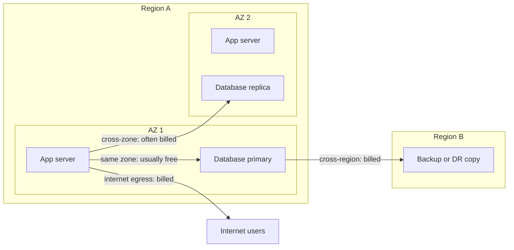
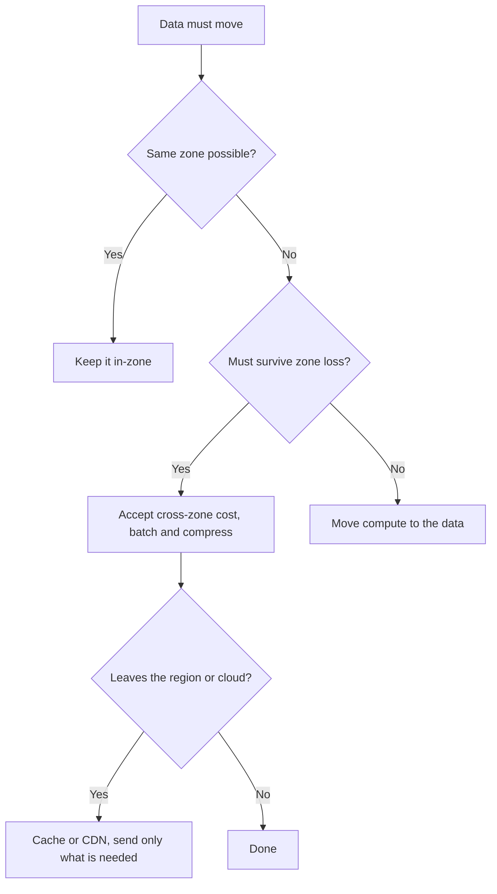

# Cloud Egress and Data Transfer Costs Explained

> **9-minute read. Assumes you've read [Cloud cost basics](./cloud-cost-basics.md) and [Regions and availability zones](./regions-and-availability-zones.md).**

## The one-line answer

Moving data **into** a cloud is usually free. Moving it **out**, **across regions**, and often **across availability zones** is billed per gigabyte. The charge depends on where the two ends of the transfer sit, not on how much compute you run.

That is why egress shows up as a surprise. Nothing on your laptop charges for traffic, and nothing in the console warns you when an architecture quietly sends the same gigabytes across a billing boundary a million times.

This page gives you a way to read any architecture and spot those boundaries. It does not quote prices. Rates change and differ by region, so read them from the vendor pages at the end.

## The mental model: billing boundaries

Think of every transfer as a line drawn between two points. Cost depends on which boundaries the line crosses.

The diagram shows four paths from one app server. Staying in the same zone is cheapest, crossing zones is usually metered, crossing regions is metered at a higher rate, and leaving to the internet is metered most prominently.

The common tiers, from cheapest to most expensive in general:

| Boundary crossed | Typical billing |
|---|---|
| Same zone, private IP | Usually free |
| Different zone, same region | Often billed, sometimes in both directions |
| Different region, same provider | Billed, rate depends on the region pair |
| To the internet | Billed |
| Into the cloud from the internet | Usually free |

"Usually" and "often" are deliberate. Providers differ, and the rules change. Check the pricing page for your provider before you build a business case on any row.

## How the three providers differ

The shape is the same everywhere. The details are not.

- **AWS** bills data transfer between availability zones in the same region. Traffic between zones is charged in each direction, so a request-and-response pair pays twice. Traffic within one zone over private IPs is not charged. See the AWS architecture blog on data transfer costs for worked patterns.
- **Google Cloud** does not charge for egress within the same zone over internal IPs, but does charge for traffic between zones in a region and between regions. Internet egress price depends on the **Network Service Tier** you pick: Premium (traffic rides Google's backbone as far as possible) or Standard (traffic exits to the public internet closer to the source).
- **Azure** bills outbound internet data and inter-region transfer. Inbound is free. Check the bandwidth pricing page for how traffic between availability zones is treated, because that has been the most changeable row.

**[📖 AWS: Overview of data transfer costs for common architectures](https://aws.amazon.com/blogs/architecture/overview-of-data-transfer-costs-for-common-architectures/)** - the clearest official walk through which hops are billed and which are not

**[📖 Google Cloud: VPC network pricing](https://cloud.google.com/vpc/network-pricing)** - the full table of same-zone, cross-zone, cross-region and internet rules

**[📖 Google Cloud: Network Service Tiers overview](https://cloud.google.com/network-tiers/docs/overview)** - Premium versus Standard and what each means for routing

**[📖 Azure: Bandwidth pricing](https://azure.microsoft.com/en-us/pricing/details/bandwidth/)** - inbound, outbound and inter-region rules by zone

## A worked example: finding the hidden hops

Take a plain web app and trace where the bytes go. No prices here, only counting.

Setup: an app runs in two zones behind a load balancer. It reads images from object storage, queries a database whose replica sits in the other zone, and writes logs to a central logging service.

For one user request that returns a 2 MB page:

1. **User to load balancer.** Inbound, free.
2. **Load balancer to app server.** If the balancer picks a server in a different zone, this can be a cross-zone hop. Many load balancers have a setting that controls cross-zone distribution, and the default differs by product. Check it.
3. **App to database.** If the app is in zone 1 and the primary is in zone 2, every query and result crosses a zone boundary. Chatty ORMs make dozens of queries per request.
4. **App to object storage.** Same region, free on most providers. But if the app reaches storage through a **NAT gateway** instead of a private endpoint, you pay a per-gigabyte processing fee on top. See [VPC explained](./vpc-explained.md).
5. **App to user.** The 2 MB response is internet egress.
6. **App to logging.** Verbose logs shipped across zones or regions are billed as transfer, plus the logging service's own ingest fee.

Count the hops, not the dollars. Steps 2, 3, 4 and 6 are the invisible ones. A request that looks like "2 MB out" may touch five billing meters. Multiply by requests per day and you can see why the line item grows faster than traffic does.

## Where surprise bills come from

Most egress incidents fall into a few repeatable patterns.

**1. NAT gateway as the default route for everything.** On AWS, a NAT gateway charges per hour and per gigabyte it processes. Sending S3 or DynamoDB traffic through it is wasted spend. AWS offers **gateway endpoints** for S3 and DynamoDB that carry no additional charge. Interface endpoints (PrivateLink) do have hourly and per-gigabyte charges, so they trade a NAT bill for a different one.

**2. Cross-zone chatter.** Services that call each other thousands of times per second, spread across zones for availability, pay for every call. High availability needs zones. You can still keep **tight call chains** in one zone and replicate only what must survive a zone loss.

**3. Replication and backups across regions.** Disaster recovery is a deliberate cost: the copy is billed, and so is every changed byte you ship. See [Disaster recovery: RPO and RTO](./disaster-recovery-rpo-rto.md). Replicate what the recovery objective demands, not the whole estate.

**4. Serving large files straight from origin.** A popular download served from object storage pays internet egress on every request. Put a CDN in front, so repeat requests are answered from the cache instead of the origin. Check your provider's pricing page for how origin-to-CDN transfer is billed. See [CDN explained](./cdn-explained.md).

**5. Cross-cloud and hybrid traffic.** Data leaving one cloud for another, or for your data center, is internet or dedicated-link egress. A multi-cloud design that moves data between providers on every request pays egress both architecturally and every day. See [Multi-cloud networking](../../resources/networking-deep-dives/multi-cloud-networking.md).

**6. Analytics that pull data to the compute.** Running a query engine in region B against data in region A repeats the transfer on every run. Move the compute, not the data. For data-platform patterns, see the [Data Zero to Hero](https://data.noblerworks.com/) site.

**7. Verbose logging and metrics.** Telemetry is data too. Debug-level logs from a fleet add up in transfer and in ingest charges.

## A decision rule for placement

Use this order when you design, before you reach for optimisation tricks:

1. **Co-locate things that talk a lot.** Put chatty services and their database in the same zone, then add a replica elsewhere for failure, not for reads on the hot path.
2. **Use private endpoints for provider services** (storage, queues, databases) so traffic stays off the NAT path.
3. **Cache and compress before you cross a boundary.** A smaller payload is cheaper on every tier.
4. **Put a CDN in front of anything large and popular.**
5. **Keep compute in the same region as the data it reads in bulk.**
6. **Treat cross-region and cross-cloud as design decisions**, written down with an estimated monthly gigabyte figure.

If a design needs to break one of these, fine. Write down why and what it costs.

This flowchart shows the order of questions to ask when a transfer crosses a boundary: keep it local, then accept zone cost only for resilience, then minimise anything that leaves the region.

## Leaving a provider

Moving all your data out of a provider is egress like any other, so a large migration can be a large line item. If you are planning one, estimate the transfer volume early and check each vendor's current pricing and terms page. Do not assume any fee will be reduced. See the [cloud-to-cloud migration guide](../../resources/migration-guides/cloud-to-cloud.md).

## How to see your own transfer costs

You cannot fix what you cannot see. Do this before you optimise.

1. **Group the bill by usage type.** In AWS Cost Explorer, filter on usage types containing `DataTransfer` or `NatGateway`. Azure Cost Management and Google Cloud billing reports can group by meter or SKU.
2. **Turn on flow logs** for the busiest VPCs or VNets, then aggregate bytes by source, destination and port. This tells you which services talk, not just how much.
3. **Tag by workload**, so a transfer line item has an owner. See [FinOps principles](../../resources/cost-optimization/finops-principles.md).
4. **Set a budget alert on the networking category.** Anomaly alerts catch a runaway sync job faster than a monthly review.

## Common mistakes

- **Assuming "same region" means free.** Cross-zone traffic inside a region is often billed.
- **Using NAT for traffic that has a free endpoint.**
- **Spreading a chatty call chain across zones** without measuring the transfer.
- **Replicating everything cross-region** "just in case."
- **Benchmarking in one zone, then deploying across three.** Costs change with the topology.
- **Ignoring logs and metrics** as a data stream.
- **Quoting a transfer rate from a blog post.** Use the vendor's current pricing page.

## What to look at next

- **[Cloud cost basics](./cloud-cost-basics.md)** - the full list of what you pay for
- **[VPC explained](./vpc-explained.md)** - where NAT gateways and endpoints sit
- **[CDN explained](./cdn-explained.md)** - the main tool for cutting internet egress
- **[AWS cost optimization](../../resources/cost-optimization/aws-cost-optimization.md)** - provider-specific savings
- **[Hybrid connectivity deep dive](../../resources/networking-deep-dives/hybrid-connectivity.md)** - dedicated links and their transfer pricing

## Check yourself

Try these before you move on. Each answer is collapsed; click it to check yourself.

1. Name three boundaries a transfer can cross that are commonly billed.

    

    
Answer

    Between availability zones in a region, between regions, and out to the internet. Inbound transfer is usually free. See: <a href="#the-mental-model-billing-boundaries">The mental model</a>
    

2. Why can sending S3 traffic through a NAT gateway cost more than it should?

    

    
Answer

    A NAT gateway charges per gigabyte it processes, while a gateway endpoint for S3 has no additional charge. See: <a href="#where-surprise-bills-come-from">Where surprise bills come from</a>
    

3. A chatty service and its database are in different zones. What is the cost, and what is the fix?

    

    
Answer

    Every query and result crosses a zone boundary and is usually billed. Co-locate the hot path in one zone and keep replicas in other zones for failure. See: <a href="#a-decision-rule-for-placement">A decision rule for placement</a>
    

4. How would you find out where your own transfer costs come from?

    

    
Answer

    Group the bill by usage type or meter, enable flow logs, tag by workload, and alert on the networking category. See: <a href="#how-to-see-your-own-transfer-costs">How to see your own transfer costs</a>
    

