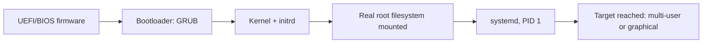

# Domain 1: System Management (23%)

## Overview

System Management is the largest domain on XK0-006 and the most "hands on keyboard". It covers how a Linux server boots, where things live on disk, how devices and kernel modules are managed, how storage is carved up with partitions, LVM and RAID, how the network is configured, how you work at a shell, how you back up and restore, and how virtualization fits in. Everything in later domains (users, services, security) assumes you can move around this one without thinking.

The seven objectives, as written in the official objectives document:

- **1.1** Explain basic Linux concepts.
- **1.2** Summarize Linux device management concepts and tools.
- **1.3** Given a scenario, manage storage in a Linux system.
- **1.4** Given a scenario, manage network services and configurations on a Linux server.
- **1.5** Given a scenario, manage a Linux system using common shell operations.
- **1.6** Given a scenario, perform backup and restore operations for a Linux server.
- **1.7** Summarize virtualization on Linux systems.

**[📖 CompTIA Linux+ XK0-006 Exam Objectives (PDF, version 5.0)](https://lecbyo.files.cmp.optimizely.com/download/90b9ac985c0e11f0b004a2a93c999a21)** - The official list of every topic and tool named in this domain

## 1.1 Basic Linux concepts

### The boot process

A server boots in a fixed order, and troubleshooting questions ask you to place a failure on that line. Firmware (UEFI or legacy BIOS) runs first and finds a bootloader. On most distributions the bootloader is GRUB 2, configured by files such as `/etc/default/grub` and a generated `grub.cfg`. The bootloader loads the kernel and the **initial RAM disk** (initrd, also called initramfs). The initrd is a small temporary root filesystem holding the drivers needed to find the real root filesystem, for example an LVM or RAID driver. Once the kernel mounts the real root, it starts the init system (systemd), which brings up services and reaches a target.

Kernel parameters are passed on the bootloader's command line and shown in `/proc/cmdline`. A common example is `systemd.unit=rescue.target` to boot into a rescue environment. **PXE** (Preboot Execution Environment) lets a machine boot from the network instead of a local disk, using DHCP and TFTP or HTTP. It is the basis of unattended installs (see Domain 4).



*The boot chain, in order. A failure at each step has a different symptom: no bootloader menu, a kernel panic, a dropped-to-emergency-shell mount failure, or a failed unit.*

### Filesystem Hierarchy Standard

The **FHS** says where things go. The exam names these directories, so know the job of each:

| Path | Holds |
|---|---|
| `/` | The root of the tree |
| `/bin`, `/sbin` | Essential user and administrator binaries (on modern distributions these are often symlinks into `/usr`) |
| `/boot` | Kernel, initrd and bootloader files |
| `/dev` | Device files |
| `/etc` | System-wide configuration, text files |
| `/home` | User home directories |
| `/lib` | Shared libraries and kernel modules needed to boot |
| `/proc` | Virtual filesystem exposing kernel and process information |
| `/tmp` | Temporary files, often cleared at boot |
| `/usr` | Installed software, libraries and documentation |
| `/var` | Variable data: logs, spool, caches |

**[📖 Filesystem Hierarchy Standard 3.0](https://refspecs.linuxfoundation.org/FHS_3.0/fhs/index.html)** - The specification behind the directory layout

### Architectures, distributions, GUI and licensing

Server architectures named by the objectives are x86, x86_64/AMD64, AArch64 (64-bit ARM) and RISC-V. You install software built for your architecture, which is why a package name often ends in `x86_64` or `aarch64`.

Distributions fall into two package families. **RPM-based** distributions (Red Hat Enterprise Linux, Fedora, Rocky, AlmaLinux, SUSE) use the RPM Package Manager. **dpkg-based** distributions (Debian, Ubuntu) use dpkg. The commands differ, and Domain 2 covers them.

Servers usually run without a **GUI**. When one exists, a **display manager** presents the login screen, a **window manager** draws and arranges windows, and the display protocol is either the older **X Server** (X11) or **Wayland**. X11 can forward windows over SSH; Wayland does not natively work that way, which matters when you harden SSH.

Software licensing questions test vocabulary. **Open source** means the source is available under a license that allows use, study and change. **Free software** is the Free Software Foundation's term, about freedoms rather than price. **Copyleft** licenses (the GPL is the classic example) require derived work to be distributed under the same terms. **Proprietary** software restricts those rights.

## 1.2 Device management

Linux exposes hardware through the kernel, and most hardware support arrives as **kernel modules** (drivers loaded on demand). The tools come in two groups: ones that manage modules and ones that report what hardware exists.

| Task | Tool |
|---|---|
| List loaded modules | `lsmod` |
| Show information about a module | `modinfo <module>` |
| Load a module and its dependencies | `modprobe <module>` |
| Unload a module (with dependencies) | `modprobe -r <module>` |
| Insert or remove a single module file with no dependency handling | `insmod <file.ko>` / `rmmod <module>` |
| Rebuild the module dependency map | `depmod` |
| Kernel ring buffer messages (device detection, errors) | `dmesg` |

`modprobe` is almost always the right answer for loading, because it reads `depmod`'s dependency data and loads prerequisites. `insmod` is the low-level tool that fails if a dependency is missing.

Hardware reporting tools:

- `lscpu` - CPU model, cores, architecture and virtualization support.
- `lsmem` - memory ranges and their state.
- `lspci` and `lsusb` - devices on the PCI and USB buses.
- `lshw` - a full hardware inventory.
- `dmidecode` - firmware (DMI/SMBIOS) data such as serial numbers and memory slots.
- `lm_sensors` (the `sensors` command) - temperatures and fan speeds.
- `ipmitool` - talks to a server's baseboard management controller for remote power and sensor control.
- `nvtop` - GPU utilization, relevant to the GPU use cases the objectives list.

**initrd management.** When you change something needed early in boot (a storage driver, for example) you must regenerate the initrd. On RPM-based systems that is `dracut`; `mkinitrd` is the older tool. For example, `dracut --force` rebuilds the image for the running kernel. If a module is missing from the initrd, the symptom is a boot that cannot find the root filesystem.

**[📖 modprobe(8)](https://man7.org/linux/man-pages/man8/modprobe.8.html)** - How modules are loaded, with dependency handling

## 1.3 Storage

Storage is where the exam gets most practical. Work through the stack from bottom to top: disk, partition, (optionally RAID or LVM), filesystem, mount.

### Partitions

`lsblk` shows block devices as a tree, `blkid` shows UUIDs and filesystem types, and `fdisk` (MBR or GPT), `gdisk` (GPT) and `parted` create partitions. After you enlarge a cloud disk, `growpart` extends a partition into the new space. Using a **UUID** in `/etc/fstab` instead of `/dev/sdb1` is the safe habit, because device names can change between boots.

### LVM

The Logical Volume Manager adds a flexible layer between disks and filesystems. There are three object types, and every command name starts with the abbreviation of the layer it works on: `pv` for physical volumes, `vg` for volume groups, `lv` for logical volumes.

```bash
pvcreate /dev/sdb1 /dev/sdc1          # mark partitions as physical volumes
vgcreate vg_data /dev/sdb1 /dev/sdc1  # pool them into a volume group
lvcreate -n lv_app -L 20G vg_data     # carve a 20 GiB logical volume
mkfs.xfs /dev/vg_data/lv_app          # put a filesystem on it
mount /dev/vg_data/lv_app /srv/app
```

The reason to use LVM is growth. To add 10 GiB to a mounted logical volume and its filesystem in one step:

```bash
lvextend -r -L +10G /dev/vg_data/lv_app   # -r (--resizefs) also grows the filesystem
```

Without `-r`, you grow the filesystem separately: `xfs_growfs /srv/app` for XFS (takes the mount point) or `resize2fs /dev/vg_data/lv_app` for ext4. XFS can be grown but never shrunk; ext4 can be shrunk offline. Know the inspection commands too: `pvs`, `vgs`, `lvs` for short summaries and `pvdisplay`, `vgdisplay`, `lvdisplay` for detail. `pvmove` migrates data off a physical volume so you can remove a failing disk, and `vgextend` adds a new physical volume to a group.

**[📖 lvcreate(8)](https://man7.org/linux/man-pages/man8/lvcreate.8.html)** - Logical volume creation options
**[📖 xfs_growfs(8)](https://man7.org/linux/man-pages/man8/xfs_growfs.8.html)** - Growing a mounted XFS filesystem

### Filesystems

| Format | Notes |
|---|---|
| **ext4** | The long-standing default on many distributions. Journaled, can grow and (offline) shrink |
| **xfs** | Default on RHEL family. High performance with large files and parallel I/O. Grow only |
| **btrfs** | Copy-on-write with snapshots, checksums and built-in subvolumes |
| **tmpfs** | A filesystem in RAM, used for `/tmp` or `/run`. Contents vanish at reboot |

Create with `mkfs` (for example `mkfs.ext4 /dev/sdb1`). Check and repair unmounted filesystems with `fsck` (ext4) or `xfs_repair` (XFS). Report usage with `df` (filesystem level) and `du` (directory level). `fio` benchmarks disk performance.

**Inodes** are the records that store file metadata. A filesystem can have free space yet run out of inodes if it holds millions of tiny files; `df -i` shows inode usage, and Domain 5 returns to this as "inode exhaustion".

### Mounting

A manual mount is `mount /dev/sdb1 /mnt/data` and the reverse is `umount /mnt/data`. A permanent mount is a line in `/etc/fstab` with six fields: device, mount point, filesystem type, options, dump flag and fsck pass number.

```text
UUID=3f2a9c1e-0000-4c1d-9a55-aaaaaaaaaaaa  /data  xfs  defaults,noatime,nodev,nosuid  0  0
```

Mount options named by the objectives:

| Option | Effect |
|---|---|
| `noatime`, `nodiratime` | Do not update access times on files or directories (less write I/O) |
| `nodev` | Ignore device files on this filesystem |
| `noexec` | Block execution of binaries |
| `nosuid` | Ignore setuid and setgid bits |
| `nofail` | Do not fail the boot if the device is absent |
| `ro` / `rw` | Read-only or read-write |
| `remount` | Change options of an already mounted filesystem, e.g. `mount -o remount,ro /data` |

`/proc/mounts` shows what is mounted right now (`/etc/mtab` is a link to the same data). `autofs` mounts a path on demand and unmounts it after idle time, which suits network shares. Test an `fstab` edit with `mount -a` before you reboot: a bad line can drop a server into emergency mode.

**Network mounts** use NFS (`mount -t nfs server:/export /mnt`) or SMB/Samba (`mount -t cifs //server/share /mnt -o username=...`).

**[📖 fstab(5)](https://man7.org/linux/man-pages/man5/fstab.5.html)** - The six fields and their meaning

### Software RAID

Linux software RAID is managed with `mdadm`, and `/proc/mdstat` shows array health. Know the levels: RAID 0 stripes (speed, no redundancy), RAID 1 mirrors, RAID 5 stripes with single parity (needs three disks), RAID 6 uses double parity, and RAID 10 is a stripe of mirrors.

```bash
mdadm --create /dev/md0 --level=1 --raid-devices=2 /dev/sdb1 /dev/sdc1
cat /proc/mdstat
mdadm --detail /dev/md0
mdadm /dev/md0 --fail /dev/sdb1 --remove /dev/sdb1   # retire a failed member
mdadm /dev/md0 --add /dev/sdd1                       # add the replacement
```

**[📖 mdadm(8)](https://man7.org/linux/man-pages/man8/mdadm.8.html)** - Create, assemble, manage and monitor md arrays

## 1.4 Network configuration

Name resolution on a Linux host is driven by three files. `/etc/hosts` holds static name-to-address mappings. `/etc/resolv.conf` lists DNS servers (often managed by systemd-resolved or NetworkManager rather than edited by hand). `/etc/nsswitch.conf` sets the lookup order, for example `hosts: files dns` means check `/etc/hosts` first, then DNS.

Persistent interface configuration comes from one of two stacks. RHEL-family systems use **NetworkManager** and its `nmcli` command:

```bash
nmcli device status
nmcli connection modify eth0 ipv4.method manual \
  ipv4.addresses 192.0.2.10/24 ipv4.gateway 192.0.2.1 ipv4.dns 192.0.2.53
nmcli connection up eth0
```

Ubuntu servers use **Netplan**, which reads YAML in `/etc/netplan` and renders it to NetworkManager or systemd-networkd:

```yaml
network:
  version: 2
  ethernets:
    eth0:
      addresses: [192.0.2.10/24]
      routes:
        - to: default
          via: 192.0.2.1
      nameservers:
        addresses: [192.0.2.53]
```

`netplan try` applies a change and rolls it back after a timeout unless you confirm it, which protects you from locking yourself out of a remote server. `netplan apply` applies it permanently, and `netplan status` shows the current state.

**[📖 nmcli reference](https://networkmanager.dev/docs/api/latest/nmcli.html)** - NetworkManager command-line client
**[📖 Netplan YAML reference](https://netplan.readthedocs.io/en/stable/netplan-yaml/)** - Every key Netplan accepts

### Network tools

| Need | Tool |
|---|---|
| Show or change addresses, links and routes | `ip address`, `ip link`, `ip route` |
| Link speed, duplex and driver | `ethtool` |
| Connectivity | `ping` / `ping6` |
| Path to a host | `traceroute`, `tracepath`, `mtr` (continuous, combines both) |
| Listening and connected sockets | `ss` (replaces `netstat`) |
| Name resolution | `dig`, `nslookup` |
| Packet capture | `tcpdump` |
| Port scan | `nmap` |
| Throughput between two hosts | `iperf3` |
| Raw TCP/UDP connections | `nc` |
| HTTP requests | `curl` |
| Neighbor (ARP) table | `arp` |

A common exam pattern: `ss -tlnp` lists TCP listening sockets with numeric ports and the owning process, which answers "is the service actually listening, and on which address?"

**[📖 ss(8)](https://man7.org/linux/man-pages/man8/ss.8.html)** - Socket statistics options

## 1.5 Shell operations

### Environment and paths

Variables the objectives name: `HOME`, `USER`, `SHELL`, `PATH` (directories searched for commands), `PS1` (the prompt) and `DISPLAY` (which X display to use). An **absolute** path starts at `/`; a **relative** path starts from the current directory, using `.` (here), `..` (parent) and `~` (home). `-` as an argument to `cd` returns to the previous directory.

Login shells read `/etc/profile`, then `~/.bash_profile` or `~/.profile`. Interactive non-login shells read `~/.bashrc`. Put aliases in `.bashrc`, and `source ~/.bashrc` to reload without logging out.

### Redirection and pipes

| Operator | Meaning |
|---|---|
| `>` | Send standard output to a file, overwrite |
| `>>` | Append standard output |
| `<` | Read standard input from a file |
| `2>` | Send standard error to a file |
| `\|` | Pipe one command's output to the next |
| `<<EOF` | Here document: inline multi-line input |
| `<<<` | Here string: a single string as input |

`command > out.txt 2>&1` sends both streams to one file. `tee` writes to a file and to the screen at once: `dmesg | tee boot.log | grep -i error`.

### Text utilities

You are expected to chain these: `cat`, `head`, `tail` (`tail -f` follows a log), `less`, `grep`, `cut`, `sort`, `uniq`, `wc`, `tr`, `sed`, `awk`, `xargs`, `printf`, `echo`, `history`, `uname`, `bc`. History expansion: `!!` repeats the last command and `!n` repeats history entry n. Editors are `vi`/`vim` and `nano`.

```bash
# Top five client addresses in a web log
awk '{print $1}' /var/log/nginx/access.log | sort | uniq -c | sort -rn | head -5
# Replace text in place, keeping a backup
sed -i.bak 's/old.example.com/new.example.com/g' app.conf
# Run a command on every file found
find /var/log -name '*.old' -mtime +30 -print0 | xargs -0 rm -f
```

## 1.6 Backup and restore

| Tool | Purpose |
|---|---|
| `tar` | Bundle files into an archive; add `-z`, `-j` or `-J` for gzip, bzip2 or xz compression |
| `cpio` | Another archiver, reads a file list from standard input |
| `rsync` | Copies only differences, locally or over SSH. The backbone of most file backups |
| `dd` | Block-level copy of a disk or partition |
| `ddrescue` | Block copy that keeps going past read errors, for failing disks |
| `gzip`, `bzip2`, `xz`, `7-Zip`, `unzip` | Compression; `zcat`, `zgrep`, `zless` read compressed files without unpacking |

```bash
tar -czf /backup/etc-$(date +%F).tar.gz /etc      # create compressed archive
tar -tzf /backup/etc-2026-11-07.tar.gz            # list contents
tar -xzf /backup/etc-2026-11-07.tar.gz -C /restore etc/ssh/sshd_config   # restore one file
rsync -a --delete /srv/app/ backup01:/backups/app/   # mirror, preserving permissions
dd if=/dev/sdb of=/backup/sdb.img bs=4M status=progress   # whole-disk image
```

Choosing between them is the scenario skill. Use `rsync` for repeated file sync, `tar` for a point-in-time archive, `dd` when you need an exact block copy including the partition table, and `ddrescue` when the source disk is dying. A trailing slash on the `rsync` source (`/srv/app/`) means "the contents of", not the directory itself.

**[📖 tar(1)](https://man7.org/linux/man-pages/man1/tar.1.html)** - Archive creation, listing and extraction
**[📖 rsync(1)](https://man7.org/linux/man-pages/man1/rsync.1.html)** - Synchronization options including `-a` and `--delete`

## 1.7 Virtualization

Linux virtualization is built from **KVM** (the in-kernel hypervisor that uses CPU virtualization extensions) and **QEMU** (the userspace emulator that provides the virtual hardware). **libvirt** is the management layer, with `virsh` as its command line and `virt-manager` as its GUI. **VirtIO** is a set of paravirtualized drivers: the guest knows it is virtual and uses an efficient interface for disk and network instead of emulating a physical card.

Operations to recognize: converting and resizing disk images (`qemu-img convert`, `qemu-img resize`), checking image properties (`qemu-img info`), taking **snapshots**, **cloning** from a baseline image template, live **migration** between hosts, and **nested virtualization** (a hypervisor inside a VM, needing the host to expose the CPU extensions). VM state commands in `virsh` include `list --all`, `start`, `shutdown`, `suspend` and `snapshot-create-as`.

Virtual network types:

| Type | Behavior |
|---|---|
| **Bridged** | The VM appears on the physical network with its own address |
| **NAT** | The VM shares the host's address; outbound works, inbound needs forwarding |
| **Host-only / isolated** | VMs and the host can talk, nothing leaves |
| **Routed** | The host routes between the virtual network and the physical one, no address translation |
| **Open** | The virtual network has no firewall rules applied by the hypervisor |

Bare metal gives the best performance and direct hardware access; virtual machines give isolation, density, snapshots and fast provisioning.

## Common exam traps

- Growing a logical volume does not grow the filesystem unless you use `-r` or run `xfs_growfs`/`resize2fs`.
- `xfs_growfs` takes a mount point; `resize2fs` takes a device.
- `modprobe` handles dependencies; `insmod` does not.
- A full disk and a full inode table both produce "No space left on device". Check `df -h` and `df -i`.
- Editing `/etc/fstab` with a typo can break boot. `nofail` and `mount -a` are the safety nets.
- `netplan try` rolls back; `netplan apply` does not.

## Key terms

- **initrd** - the initial RAM disk, a small temporary root filesystem the kernel uses to load the drivers needed to mount the real root filesystem.
- **PXE** - the Preboot Execution Environment, which lets a machine boot over the network instead of from a local disk.
- **FHS** - the Filesystem Hierarchy Standard, which defines what each top-level directory such as /etc, /var and /usr is for.
- **GRUB** - the common Linux bootloader that loads the kernel and initrd.
- **Kernel module** - a driver or feature that can be loaded into or removed from the running kernel on demand.
- **modprobe** - loads or removes a kernel module together with the modules it depends on.
- **dracut** - the tool that builds the initramfs image on RPM-based distributions.
- **dmidecode** - reads firmware (DMI/SMBIOS) tables to report hardware details such as serial numbers and memory slots.
- **LVM** - the Logical Volume Manager, which pools physical volumes into volume groups and carves out resizable logical volumes.
- **Physical volume** - a disk or partition prepared with pvcreate so LVM can use it.
- **Volume group** - a pool of storage made from one or more physical volumes, created with vgcreate.
- **Logical volume** - a resizable block device carved from a volume group, created with lvcreate.
- **xfs_growfs** - expands a mounted XFS filesystem to fill its underlying device; XFS cannot be shrunk.
- **resize2fs** - resizes an ext2, ext3 or ext4 filesystem.
- **Inode** - a filesystem record holding a file's metadata; running out of inodes blocks new files even when free space remains.
- **fstab** - /etc/fstab, the file listing filesystems to mount at boot with their options.
- **nofail** - an fstab mount option that stops a missing device from failing the boot.
- **noexec** - a mount option that prevents programs on that filesystem from being executed.
- **autofs** - mounts a filesystem on demand when a path is accessed and unmounts it after it has been idle.
- **mdadm** - the tool for creating and managing Linux software RAID arrays.
- **/proc/mdstat** - a kernel file showing the state and sync progress of software RAID arrays.
- **NetworkManager** - the service that manages network connections, controlled with nmcli on RHEL-family systems.
- **Netplan** - an Ubuntu network configuration layer that reads YAML in /etc/netplan and renders it for a backend.
- **netplan try** - applies Netplan configuration temporarily and reverts it automatically unless you confirm.
- **nsswitch.conf** - the file that sets the order of sources, such as files then dns, used for name lookups.
- **ss** - the tool that shows socket statistics, replacing netstat.
- **tee** - copies standard input to both a file and standard output.
- **rsync** - copies only the differences between source and destination, locally or over SSH.
- **ddrescue** - copies data from a failing disk while skipping and logging unreadable areas.
- **KVM** - the Kernel-based Virtual Machine, the Linux kernel's built-in hypervisor.
- **QEMU** - the userspace emulator that supplies virtual hardware to KVM guests.
- **VirtIO** - paravirtualized drivers that let a guest use efficient virtual disk and network devices.
- **libvirt** - the management API and toolset behind virsh and virt-manager.
- **Bridged network** - a virtual network type where the VM sits directly on the physical network with its own address.
