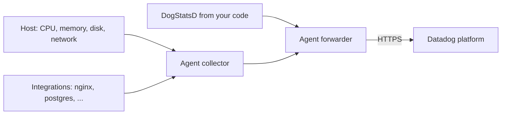

# 02 - Infrastructure: Installing and Running the Agent

**Exam guide domain 2: Infrastructure Development**

Subdomains in the guide: Agent installation, API key, application key, running the Agent, Agent hostname.

The exam guide lists the subdomains without weights. Commands in this note are quoted in shape from the Datadog documentation and were not run for this guide, because installing the Agent needs a Datadog account and an API key. Always copy the exact install command for your platform from the Datadog Agent installation page, since it embeds your key and your site.

---

## What the Agent does

The **Datadog Agent** is software that runs on a host (or as a container) and does three jobs. It **collects** data: system metrics such as CPU, memory, disk and network by default, and more through integrations. It **receives** data: local applications can send it custom metrics, traces and logs. And it **forwards** everything to Datadog over an encrypted connection, buffering for a short time if the network is down.

The important structural point is that the Agent is **one program made of several cooperating parts**. A collector runs checks, a forwarder sends data on, and optional components handle DogStatsD, APM traces, log collection and process monitoring. You turn the optional ones on in configuration. That is why one install can grow from "host metrics only" to "metrics, logs and traces" without reinstalling.



The diagram shows system checks and integration checks feeding the collector, custom metrics arriving at the Agent's local listener, and the forwarder sending everything onward to the Datadog platform over HTTPS.

**[📖 Datadog docs: Agent](https://docs.datadoghq.com/agent/)** - architecture and platform guides

---

## Datadog sites

Datadog runs several independent **sites**, each in a region with its own web address. Your organization lives in exactly one. The common sites include the US sites, an EU site, an Asia-Pacific site and a US government site. The Agent must be told which site to send to, using the `site` setting or the `DD_SITE` variable, and the API base address changes with the site.

This detail is worth remembering because it is the most common reason a freshly installed Agent never shows up: the key is valid, but it is being sent to the wrong site. The docs' "Datadog sites" page lists each site and its address. The URL you use to log in to the web interface tells you which site you are on.

**[📖 Datadog docs: Getting started with Datadog sites](https://docs.datadoghq.com/getting_started/site/)** - site names and addresses

---

## API key and application key

Two kinds of credential exist, and the exam checks that you can tell them apart.

### API key

The **API key** identifies your **organization**. The Agent uses it to prove that the data it sends belongs to your account. Anyone with the API key can submit data to your organization, so it must be kept secret, but it does not allow reading data back.

You find and create keys in **Organization Settings** in the web interface, under API keys. Organizations can have several keys, which is good practice: one per environment or per team, so that revoking one does not interrupt everything. A key can be revoked or rotated without touching the others.

### Application key

The **application key** is tied to a **user** (or a service account) and, together with an API key, authorizes **API calls that read or manage** things: querying metrics, creating monitors, editing dashboards. It carries the permissions of the user or account that owns it, and can be scoped to limit them.

### The rule to memorize

| You want to | Credential needed |
|---|---|
| Install the Agent so a host reports in | API key |
| Submit a metric or event through the API | API key |
| Read data or manage monitors, dashboards, users through the API | API key and application key |

A short phrase captures it: **the API key lets data in; the application key plus the API key lets you act on the account.** When a question describes an automation script that creates monitors, the answer includes an application key. When it describes a host that should start reporting, only the API key is needed.

Both go in request headers when you call the API: `DD-API-KEY` and `DD-APPLICATION-KEY`. Keys are best stored in a secrets manager and injected at deployment time, never committed to a repository. If a key leaks, you revoke it in the web interface and issue a new one.

**[📖 Datadog docs: API and application keys](https://docs.datadoghq.com/account_management/api-app-keys/)** - creating, scoping and rotating

---

## Agent installation

The Agent is installed in several ways, and the right one depends on where it will run.

### The one-line installer (Linux)

The Datadog **Agent installation page** generates a command containing your key and your site. Its shape is a shell one-liner that sets environment variables and runs Datadog's install script:

```bash
DD_API_KEY=<YOUR_API_KEY> DD_SITE="datadoghq.com" bash -c "$(curl -L https://install.datadoghq.com/scripts/install_script_agent7.sh)"
```

Read it the way the shell does. Two variables are set only for this command. `curl -L` downloads the script, following redirects. `bash -c "$( ... )"` runs the downloaded text. The script detects the distribution, adds Datadog's package repository, installs the `datadog-agent` package, writes your key into the configuration file, and starts the service. The `7` in the script name is the **Agent major version**; the current major version at the time this guide was written is 7, and the installation page always shows the current one.

### Packages and configuration management

Instead of the one-liner, production environments often install through their own tooling. Datadog provides **package repositories** for apt and yum-based systems, and official modules or roles for **Ansible, Chef, Puppet** and similar tools. Those deploy the same Agent and manage the configuration files as code.

### Windows and macOS

Windows uses an **installer package** (an MSI) that can be run interactively or from the command line with parameters for the key and site. macOS has an installer and a script. The platform pages in the docs give the exact steps.

### Containers and orchestrators

On a container host the Agent runs as a **container itself**, with the host's Docker socket and some host paths mounted read-only so it can see the other containers and the host's system data. On Kubernetes it is deployed to every node as a **DaemonSet**, commonly with the Datadog Operator or Helm chart, so each node has one Agent. In these setups, settings are passed as environment variables on the container, such as `DD_API_KEY` and `DD_SITE`, rather than edited in files.

```bash
docker run -d --name dd-agent \
  -e DD_API_KEY=<YOUR_API_KEY> \
  -e DD_SITE="datadoghq.com" \
  -v /var/run/docker.sock:/var/run/docker.sock:ro \
  gcr.io/datadoghq/agent:7
```

This is a shortened form: the docs' version adds more read-only mounts for host system information. The point to take is the pattern of environment variables, the mounted socket and the versioned image.

### Cloud and serverless

For cloud services where you cannot install an Agent, such as managed databases or serverless functions, Datadog collects data through **integrations** that use the cloud provider's APIs, or through a lightweight extension or library. That idea is the "crawler" integration type in the data collection note.

**[📖 Datadog docs: Install the Agent](https://app.datadoghq.com/account/settings/agent/latest)** - the generated installer (requires a Datadog login to see your key)

---

## Running the Agent

After installation you manage the Agent like any other service. On a systemd-based Linux host:

```bash
sudo systemctl status datadog-agent
sudo systemctl start datadog-agent
sudo systemctl stop datadog-agent
sudo systemctl restart datadog-agent
```

Windows hosts use the Services console or the `Datadog Agent Manager`, and the Agent installer adds a tray application on some platforms. On containers you run, stop and restart the container.

A running service is not the same as a *working* Agent. The Agent has its own command line, `datadog-agent`, whose `status` subcommand prints a report of every component: whether the Agent can reach Datadog, which checks are running, how many metrics each collected, and any errors. This is the first command to run after a change, and the troubleshooting note covers it in depth.

```bash
sudo datadog-agent status
```

Your first hour with a new Agent follows a pattern: install, confirm the service is active, run `status`, look at the host in the **Infrastructure List** in the web interface, and open the host's detail panel to see its metrics arriving. The host usually appears within a few minutes. If it does not, check the key, the site and outbound connectivity, in that order.

---

## The Agent hostname

Every host in Datadog is identified by a **hostname**, and that name matters a great deal: it is the key that ties together metrics, logs, traces, tags and integrations from the same machine, and it is how the host is billed and listed. If a host's name changes or differs between data sources, you can end up with the same machine appearing twice.

The Agent decides its hostname by trying sources in a fixed **order of precedence**, using the first that gives an answer. In broad strokes:

1. A hostname **you set explicitly** in configuration (the `hostname` setting or the `DD_HOSTNAME` variable). This always wins, which is why it is the safe way to fix a naming problem.
2. A hostname read from a **file**, when that option is configured.
3. The name given by a **container environment or a cloud provider** when the Agent runs in one, so that a cloud instance is matched with the cloud integration's view of it.
4. The **operating system's** hostname, or its fully qualified domain name.

The exact order, and the detail for each environment, is in the docs page named in the exam guide's study list: **Canonical Hostnames**. Read it before you book, as the order has special cases for containers and cloud providers. The idea to retain is "explicit setting first, then environment-supplied names, then the operating system".

A **canonical hostname** is the one name the Agent settles on. Datadog applies some rules to make it a good identifier: names are lowercased, and certain generic names such as `localhost` are not accepted as the canonical name. Check what the Agent decided with:

```bash
sudo datadog-agent hostname
```

and compare it with what appears in the Infrastructure List. The same idea explains one of the more frequent real-world problems: two hosts cloned from the same image with the same configured hostname report as one host, with metrics that jump around. The fix is to give each a unique name or to remove the hard-coded value so the Agent derives it.

**[📖 Datadog docs: How does Datadog determine the Agent hostname?](https://docs.datadoghq.com/agent/faq/how-datadog-agent-determines-the-hostname/)** - the precedence list in full

---

## Where the infrastructure data appears

Once the Agent is reporting, the first views are:

- **Infrastructure List**: a table of hosts with their names, tags, operating system, cloud provider and the integrations running.
- **Host Map**: a visual of the same hosts, covered in the visualization note.
- **The host's detail panel**: opens when you click a host and shows metrics, tags, installed integrations and recent events.

If a question asks where to confirm that a newly installed Agent is reporting, the Infrastructure List is the best answer, and `datadog-agent status` is the local confirmation.

---

## Key terms

- **Datadog Agent** - the program that collects data on a host and forwards it to Datadog.
- **Collector** - the Agent part that runs checks and gathers metrics.
- **Forwarder** - the Agent part that sends collected data to Datadog over HTTPS.
- **Site** - one of Datadog's regional, independent platforms, which the Agent must be told to use.
- **DD_SITE** - the environment variable that sets which Datadog site the Agent sends to.
- **API key** - a secret that identifies your organization and allows data to be submitted.
- **Application key** - a secret tied to a user or service account that, with an API key, allows reading and managing through the API.
- **DD_API_KEY** - the environment variable that gives the Agent its API key.
- **Install script** - the Datadog shell script that adds the repository, installs the Agent and starts it.
- **DaemonSet** - the Kubernetes object that runs one Agent pod on each node.
- **datadog-agent status** - the Agent command that reports on every component and check.
- **Hostname** - the name that identifies a host in Datadog and ties its data together.
- **Canonical hostname** - the single name the Agent settles on after applying its precedence rules.
- **DD_HOSTNAME** - the environment variable that explicitly sets the Agent hostname.
- **Infrastructure List** - the page that lists monitored hosts with their tags and integrations.
- **Package repository** - the apt or yum source from which the Agent package is installed and updated.
