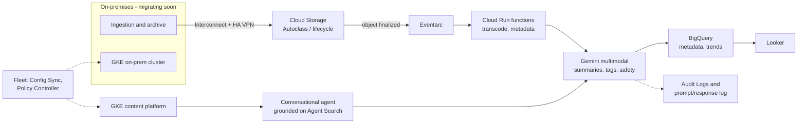
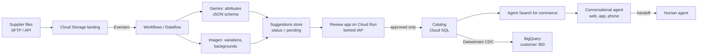
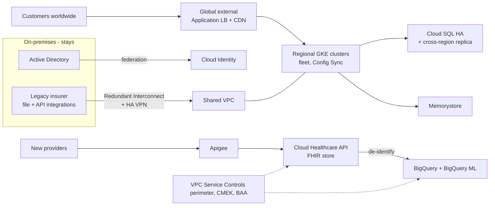
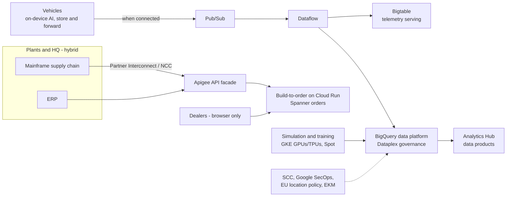

# Case Studies for the Professional Cloud Architect Exam

The current exam guide lists four case studies that questions may refer to. This note summarizes each in my own words, maps its requirements to Google Cloud design choices, and lists the traps. Read Google's originals first. They are short (one to two pages each) and the exam shows them next to the question.

**[📖 Altostrat Media case study (PDF)](https://services.google.com/fh/files/misc/v6.1_pca_altostrat_media_case_study_english.pdf)** - media library, GKE, gen AI.
**[📖 Cymbal Retail case study (PDF)](https://services.google.com/fh/files/misc/v6.1_pca_cymbal_retail_case_study_english.pdf)** - online retailer, catalog enrichment, conversational commerce.
**[📖 EHR Healthcare case study (PDF)](https://services.google.com/fh/files/misc/v6.1_pca_ehr_healthcare_case_study_english.pdf)** - SaaS health records, colocation exit, hybrid.
**[📖 KnightMotives Automotive case study (PDF)](https://services.google.com/fh/files/misc/v6.1_pca_knightmotives_automotive_case_study_english.pdf)** - car maker, AI, data monetization, EU rules.
**[📖 Professional Cloud Architect exam guide (PDF)](https://services.google.com/fh/files/misc/professional_cloud_architect_exam_guide_english.pdf)** - lists the cases and the exam sections.

> **Older material.** Earlier exam guides used Mountkirk Games, TerramEarth, Helicopter Racing League and Dress4Win. They are not in the current guide. The six worked examples in [solution-architecture-design.md](solution-architecture-design.md) are generic and still useful as design practice, but do not spend case-study time on the retired four.

## How to use a case study in the exam

1. **Read the constraints, not the story.** Business requirements say why, technical requirements say what must be true. A wrong answer usually breaks one constraint.
2. **Underline the words that filter answers:** "99.9%", "legacy", "on-premises", "no budget for new equipment", "auditable", "EU", "reduce cost", "minimal operational overhead".
3. **Prefer managed and the least change that meets the constraint.** A case that says "legacy systems will not move" means hybrid connectivity, not migration.
4. **Check the executive statement.** It states the top priority (for example reliability and cost for Altostrat).
5. **Questions test one decision at a time.** Match the decision to a design pattern below.

## 1. Altostrat Media

**Who:** a media company with a large audio and video library. Wants gen AI for discovery, support and content insight.

**Current state:** content platform on GKE, media in Cloud Storage, BigQuery as the warehouse, Cloud Run functions for event tasks (transcoding, metadata, recommendations). Some legacy on-premises systems for ingestion and archive, which the case says are slated to migrate to Google Cloud in the near future. Google Identity plus third-party IdPs. Cloud Monitoring and Prometheus, with alerts by email.

**What they need, in short:**
- Reliable workflows across Google Cloud and on-premises, simple infrastructure management.
- Lower storage cost for growing media, without losing availability.
- Natural language, 24/7 support, summaries, metadata extraction (language and vision), harmful content detection, trend insight.
- Modern CI/CD for containers, secure fast hybrid connectivity for ingestion, Kubernetes both on-premises and in cloud.
- AI that is **auditable and explainable**.

| Requirement | Design direction |
|---|---|
| Hybrid ingestion, secure and fast | Cloud Interconnect (Dedicated or Partner) with HA VPN as backup |
| Kubernetes in both places, central management | GKE Enterprise / fleets, Config Sync and policy for consistency |
| CI/CD for containers | Cloud Build and Cloud Deploy to GKE, Artifact Registry, Binary Authorization |
| Lower storage cost | Cloud Storage classes plus Autoclass or lifecycle rules (Standard to Nearline/Coldline/Archive by access pattern) |
| Metadata from media | Gemini multimodal models, Video Intelligence, Speech-to-Text, Vision |
| Summaries and chat support | Gemini via the Agent Platform, Agent Builder / conversational agents, grounded in the catalog |
| Harmful content filtering | Gemini safety settings, Model Armor on prompts and responses, Vision SafeSearch |
| Auditable, explainable AI | Cloud Audit Logs, prompt and response logging, model monitoring, Explainable AI where models are custom, documented human review |
| Insight on consumption | BigQuery, BigQuery ML, Looker |
| Alerts ignored | Alerting policies by severity, notification channels with paging, SLO-based alerts |

**Reference architecture.** Media lands in Cloud Storage over Interconnect. Each new object fires an event that runs AI enrichment, which writes metadata to BigQuery. The chat agent runs on GKE and is grounded on the catalog. One fleet manages the cloud and on-prem clusters, and every AI call is logged for audit.

**Traps:** storage cost questions want lifecycle and Autoclass, not deleting media. "Auditable and explained" is a governance requirement, so logging and review matter as much as the model. Do not pick a service that cannot run on-premises when the case demands Kubernetes on-premises. Unlike EHR, Altostrat's legacy ingestion and archive are slated to move, so a migration plan (Transfer Appliance or Storage Transfer Service into Archive class) is a valid answer.

## 2. Cymbal Retail

**Who:** a growing online retailer with a huge, messy product catalog.

**Current state:** mix of on-premises and cloud. MySQL, SQL Server, Redis, MongoDB. Kubernetes clusters. SFTP and batch ETL integrations. A custom catalog web app that searches by names and categories. An IVR with call-center agents who key in orders. Grafana, Nagios and Elastic for monitoring. Problems: manual work, data silos, hard to add new technology.

**Three goals:** automate catalog enrichment with gen AI (attributes, descriptions, images from supplier data), conversational product discovery, and modernize the stack.

**Requirements to remember:** reduce manual effort and errors, better discovery, higher conversion, lower call-center and data-center cost. Technical: attribute generation from titles, descriptions and images, image variations, natural language search, scale, **human-in-the-loop review**, data security and compliance.

| Requirement | Design direction |
|---|---|
| Attributes and descriptions from supplier text and images | Gemini multimodal models on the Agent Platform, structured output (JSON schema) |
| Image variations and edits | Imagen / image generation and editing models |
| Review before the catalog updates | HITL: a review app (Cloud Run) with approve, reject, edit. Workflows or Pub/Sub for the pipeline. Only approved items write to the catalog |
| Natural language product discovery | Agent Search (formerly Vertex AI Search) for commerce (the Discovery AI product the case names) behind a conversational agent |
| Virtual agents on web, app, and phone | Conversational Agents / Customer Engagement Suite replacing IVR menus, with handoff to a human agent |
| Databases to the cloud | Database Migration Service: MySQL and SQL Server to Cloud SQL, Redis to Memorystore, MongoDB to a managed Mongo-compatible option |
| SFTP and batch ETL | Cloud Storage with SFTP-capable transfer, Storage Transfer Service, Dataflow or Cloud Composer for pipelines, Datastream for change data capture |
| Data silos | BigQuery as the unified customer and catalog store |
| Monitoring consolidation | Cloud Monitoring, Managed Service for Prometheus, Grafana still usable |
| Security of prompts and customer chat | Model Armor, Sensitive Data Protection, CMEK, VPC Service Controls, IAM least privilege |

**Reference architecture.** Supplier data lands in Cloud Storage and triggers enrichment. Gemini and Imagen only write suggestions. Associates approve them in a review app, and only approved items reach the catalog. The catalog feeds commerce search and the conversational agent, and change data capture keeps BigQuery current.

**Traps:** gen AI output should not write straight to production, so the answer with a human review step usually wins. "Reduce data-center cost" points at migration and managed services, not new hardware. Keep PII out of prompts unless needed and protect it.

## 3. EHR Healthcare

**Who:** a SaaS provider of electronic health records to medical offices, hospitals and insurers, growing fast.

**Current state:** several colocation facilities, with a lease about to expire. Customer apps are web-based and many are containerized on Kubernetes. MySQL, SQL Server, Redis and MongoDB. Legacy file and API integrations with insurers stay **on-premises** with no plan to move them. Users in Active Directory. Open-source monitoring, with email alerts that people ignore.

**Business needs:** onboard insurers quickly, **99.9% availability**, central visibility and proactive action, healthcare trend insight and predictions, lower latency, regulatory compliance, lower admin cost.

**Technical needs:** keep legacy insurer interfaces connected to both on-premises and cloud, consistent management of containerized apps, secure and fast on-premises link, consistent logging and retention, monitoring and alerting, several container environments, scale and provision environments dynamically, interfaces to ingest data from new providers.

| Requirement | Design direction |
|---|---|
| Leave colocation, deadline set by the lease | Phased migration with Migration Center for discovery and TCO. Lift and shift VMs (Migrate to Virtual Machines) first, containers to GKE, databases with Database Migration Service |
| Legacy insurer links stay on-premises | Hybrid: Cloud Interconnect (redundant, 99.99% topology) plus HA VPN backup |
| Consistent container platform | GKE regional clusters, fleets, Config Sync, Policy Controller, GKE Enterprise for multi-environment |
| 99.9% availability | Regional (multi-zone) GKE and managed instance groups, Cloud SQL HA or Spanner, global external load balancer. Multi-region only if the DR plan requires it |
| Fast onboarding of insurers | Apigee or Cloud Endpoints for APIs, Pub/Sub and Dataflow ingestion, Cloud Storage landing for files, reusable Terraform modules |
| Users in Active Directory | Cloud Identity with federation / Workforce Identity Federation, or Managed Service for Microsoft Active Directory |
| Consistent logging and retention | Cloud Logging aggregated sinks, log buckets with retention, locked retention where required, export to BigQuery or Cloud Storage |
| Alerts ignored | Alerting policies with severity, SLO burn-rate alerts, paging and ticket integration, an incident process |
| Compliance (health data) | Business Associate Agreement, CMEK, VPC Service Controls, Assured Workloads where applicable, Cloud Healthcare API, DLP / Sensitive Data Protection, audit logs |
| Predictions and trend reports | BigQuery and BigQuery ML, Looker, de-identified datasets |
| Dynamic environments | Infrastructure as Code (Terraform), Cloud Deploy, autoscaling |

**Reference architecture.** The legacy insurer systems stay on-premises and connect over redundant Interconnect. Customers reach regional GKE clusters through a global load balancer. Databases are managed with HA and a cross-region replica for DR. New providers come in through Apigee to a FHIR store, then de-identified data goes to BigQuery, all inside a VPC Service Controls perimeter.

**Traps:** the case says legacy systems **will not move**, so answers that migrate them fail. 99.9% does not require multi-region, and a simpler regional design is correct and cheaper. Alerting fixes need routing and ownership, not more email.

## 4. KnightMotives Automotive

**Who:** a car maker with electric, hybrid and combustion models. The newer in-vehicle experience is only on electric cars. Wants one modern experience across all models within five years and better dealer tooling.

**Current state:** mostly on-premises with some public cloud. Outdated mainframe supply chain, outdated ERP, many code bases and technical debt, siloed data, obsolete AI infrastructure. Dealers have no budget for new equipment. Weak connectivity at plants and in rural areas. Past data breaches.

**Business needs:** personalized relationship with the driver, consistent experience, better build-to-order with transparency, **monetize data** to fund technology, **security paramount**, **EU data protection** (especially for autonomous platforms), invest in autonomous driving, skills and communication.

**Technical needs:** consistent AI-enabled in-vehicle UX, reliable connectivity, plant-to-HQ network upgrades, **hybrid cloud**, gradual replacement of legacy, autonomous development and a simulation environment, data platform with strong security, security framework with incident response and training, improved online ordering, dealer tools, CRM.

| Requirement | Design direction |
|---|---|
| Hybrid and plants | Cloud Interconnect or Partner Interconnect for plants, Cross-Cloud Network, SD-WAN partners. GKE Enterprise for consistent clusters |
| Outdated mainframe and ERP | Phased modernization: Mainframe modernization options (rehost, replatform, refactor), keep running during transition, wrap with APIs (Apigee) |
| Vehicle telemetry at scale | Pub/Sub ingestion, Dataflow, Bigtable or BigQuery, edge processing in the vehicle for low latency |
| Rural connectivity | Design for intermittent links: on-device inference, store and forward, sync when connected |
| Data silos and monetization | BigQuery data platform, Dataplex governance, Analytics Hub for sharing data products, Sensitive Data Protection for de-identification |
| AI infrastructure and simulation | AI Hypercomputer: GPUs and TPUs on GKE, Dynamic Workload Scheduler for capacity, large-scale simulation on batch |
| EU data protection | EU regions, Assured Workloads for EU, data residency and org policy location constraints, CMEK or External Key Manager, DLP, audit |
| Security after breaches | Security Command Center, VPC Service Controls, BeyondCorp / Context-Aware Access for staff, incident response plan, SIEM (Google Security Operations), training |
| Unreliable online ordering | Resilient, autoscaled front end (Cloud Run or GKE), Spanner or Cloud SQL HA for orders, Memorystore cache, SLOs and load testing |
| Dealers with no new equipment | Browser-based SaaS tools, no on-site hardware, identity federation for dealer users |
| CRM and personalization | Managed CRM integration, BigQuery for customer 360, Gemini for personalization with privacy controls |

**Reference architecture.** Vehicles run AI on the device and upload telemetry when connected, through Pub/Sub and Dataflow into Bigtable and BigQuery. Legacy systems get an API facade instead of a rewrite, so build-to-order and the browser-only dealer tools can use them. Simulation runs on GKE accelerators, and security and EU controls cover the data platform.

**Traps:** EU rules point at **residency, key control and auditability**, so a US multi-region answer is wrong. "Dealers have no budget" rules out solutions that need on-site hardware. Autonomous vehicle compliance is a governance requirement, so log and audit.

## Cross-case patterns

| Pattern | Seen in |
|---|---|
| Hybrid connectivity with redundancy | Altostrat, EHR, KnightMotives |
| Consistent Kubernetes across environments | Altostrat, EHR, KnightMotives |
| Gen AI with guardrails and human review | Altostrat, Cymbal |
| Legacy stays in place, integrate rather than migrate | EHR only (KnightMotives replaces legacy gradually; Altostrat migrates its legacy soon) |
| Compliance as a design driver (health, EU, PII) | EHR, KnightMotives, Cymbal |
| Alerts that nobody acts on | Altostrat, EHR |
| Data platform and insight in BigQuery | All four |
| Cost optimization of storage or data centers | Altostrat, Cymbal, EHR |

## Recall cards

One line per constraint and the design move it calls for. These feed this cert's flashcard deck.

- **Altostrat: what the executive statement ranks first** - Reliability and cost management. Break ties toward the more reliable or cheaper managed option.
- **Altostrat: are the legacy on-prem systems staying?** - No. Ingestion and archival are slated to migrate to Google Cloud soon. Plan a migration path; use hybrid links meanwhile.
- **Altostrat: masters read yearly, must stay retrievable** - Lifecycle rule to Archive class. Millisecond reads; 365-day minimum and retrieval fees fit rare access.
- **Altostrat: unpredictable access, cut storage cost** - Autoclass on the bucket: moves each object between classes by its own access pattern.
- **Altostrat: daily TB-scale ingestion from on-prem** - Redundant Dedicated (or Partner) Interconnect, HA VPN as backup. Transfer Appliance only for one-off bulk.
- **Altostrat: Kubernetes on-prem and cloud, one control** - GKE Enterprise fleet with on-prem clusters (Google Distributed Cloud), Config Sync and Policy Controller.
- **Altostrat: harmful content detection with little custom ML** - Pre-trained detection (Video Intelligence explicit content, Gemini safety settings, Vision SafeSearch) plus human review of borderline cases.
- **Altostrat: auditable and explainable AI** - Log prompts, responses and model version; Data Access audit logs; record decisions in BigQuery; Explainable AI for custom models; human review.
- **Altostrat: 24/7 chatbot that does not invent facts** - Conversational agent grounded (RAG) on an Agent Search data store of catalog and help content.
- **Altostrat: viewer sign-in with Google and third-party IdPs** - Identity Platform (customer identity). Cloud Identity / Workforce Identity Federation are for staff.
- **Cymbal: the one rule for gen AI output** - Nothing reaches the live catalog until an associate approves, rejects or edits it (human-in-the-loop).
- **Cymbal: attributes must match catalog structure** - Gemini controlled generation with a response schema (enums of allowed values per category) plus few-shot examples.
- **Cymbal: image variations, background changes, text overlays** - Imagen generation and editing on the Agent Platform. Vision API only analyzes images.
- **Cymbal: natural language product discovery, managed** - Agent Search (formerly Vertex AI Search) for commerce, the Discovery AI product, behind the conversational agent.
- **Cymbal: replace IVR and manual order entry** - Conversational Agents (Customer Engagement Suite) on web, app and phone, calling order APIs, with live-agent handoff.
- **Cymbal: millions of SKUs to enrich, latency not critical** - Batch inference jobs from Cloud Storage or BigQuery; online calls only for urgent items.
- **Cymbal: database targets** - MySQL and SQL Server to Cloud SQL via Database Migration Service; Redis to Memorystore; MongoDB to Firestore with MongoDB compatibility or MongoDB Atlas.
- **Cymbal: SFTP and batch ETL** - Land files in Cloud Storage, trigger Dataflow or Cloud Run per object via Eventarc, dead-letter bad files.
- **Cymbal: PII in chat transcripts** - Model Armor on prompts and responses; Sensitive Data Protection de-identification; CMEK and VPC Service Controls.
- **Cymbal: data silos, one view of the customer** - Datastream CDC from the operational databases into BigQuery.
- **EHR: do the legacy insurer integrations move?** - No. No plan to upgrade or move them now. Keep them on-prem and connect over redundant Interconnect plus HA VPN.
- **EHR: what 99.9% availability needs** - Regional (multi-zone) design: regional GKE, Cloud SQL HA, global LB. Multi-region is more than the target.
- **EHR: lease about to expire** - Lift and shift first (Migrate to Virtual Machines, containers to GKE), modernize after the deadline.
- **EHR: outages from misconfiguration** - Terraform in CI with policy checks; fleet with Config Sync and Policy Controller to stop drift.
- **EHR: outages from traffic spikes** - HPA plus cluster autoscaler (or Autopilot); load test to set requests and limits.
- **EHR: onboard insurers fast** - Apigee API products with keys, quotas and analytics.
- **EHR: ingest HL7v2 and FHIR from new providers** - Cloud Healthcare API stores with Pub/Sub notifications.
- **EHR: HIPAA on Google Cloud** - Sign the BAA, use covered products only, add VPC SC, CMEK, audit logs, least privilege. There is no HIPAA certification.
- **EHR: DR for databases, RPO minutes, RTO under an hour** - Cloud SQL HA plus a cross-region read replica to promote, plus backups.
- **EHR: users in Active Directory** - Federate AD into Cloud Identity (Google Cloud Directory Sync plus SSO). Managed Microsoft AD only for apps that need AD itself.
- **KnightMotives: what is paramount** - Security, after past breaches. Then EU data protection and funding through data monetization.
- **KnightMotives: rural vehicle connectivity** - Store and forward on the vehicle; Pub/Sub and Dataflow when connected; on-device inference for real-time features.
- **KnightMotives: mainframe and ERP** - Gradual: Apigee facade, replicate data to BigQuery, replace functions one at a time (strangler). Never big bang.
- **KnightMotives: dealers have no budget** - Browser-based SaaS tools with identity federation; nothing installed on site.
- **KnightMotives: unreliable build-to-order** - Autoscaled stateless front end on Cloud Run or GKE; Spanner for consistent orders and inventory.
- **KnightMotives: EU residency enforcement** - Org policy resource locations constraint (EU only) plus Assured Workloads; CMEK or EKM for key control.
- **KnightMotives: plants and other clouds** - Partner Interconnect and Network Connectivity Center for plants; Cross-Cloud Interconnect to the other cloud.
- **KnightMotives: monetize data safely** - Dataplex governance first, then Analytics Hub listings; Sensitive Data Protection for de-identification.
- **KnightMotives: security framework after breaches** - Security Command Center, Google SecOps SIEM/SOAR playbooks, incident drills, staff training, zero-trust access via IAP.
- **KnightMotives: cheap simulation at scale** - Batch or GKE on Spot VMs with GPUs/TPUs and checkpointing; Dynamic Workload Scheduler for planned runs.

## Practice

Write a one-page answer for each case: the three biggest constraints, the architecture in a Mermaid flowchart, the connectivity choice, the data choice, the security controls, and one thing you would NOT do and why. Then answer the case-study questions in [the practice questions](../../../../resources/practice-questions/gcp-cloud-architect.md): questions 41-56 and 67-109.
