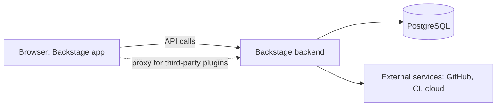

# 02 - Backstage Infrastructure

**Domain 2: Backstage Infrastructure (22%)**

Curriculum topics: understand the Backstage framework; configure Backstage; deploy Backstage to production; understand Backstage client-server architecture.

---

## The framework and its architecture

From the architecture overview:

| Part | Role |
|---|---|
| **App (frontend)** | The root of the frontend; mostly wires things together. The UI is a client-side extension that presents information from core and added plugins |
| **Backend** | The server-side part that wires things together. It is the unit of deployment, and you can run one or several |
| **Database** | Hosts Backstage data |
| **Plugins** | Frontend plugins provide features inside the app; backend plugins provide features independently |



*The browser app talks to the backend, which owns the database and reaches external systems. The backend also provides a proxy so browser requests to third-party services avoid CORS blocks.*

Facts the exam likes:

- **Core features (core plugins):** Software Catalog, Software Templates, TechDocs, Kubernetes and Search.
- **Plugin isolation:** "There can be no direct communication between plugins through code," so each backend plugin is effectively its own microservice. Plugins share capability through Utility APIs (frontend) and extension points (backend).
- **Plugin forms:** standalone (browser only, like Tech Radar), service backend (calls an internal service, like Lighthouse) and third-party backend (calls an external SaaS, like CircleCI).
- **Database:** Backstage uses Knex and sets up a separate logical database per plugin. SQLite is mainly for in-memory testing. **PostgreSQL is the preferred production database.**
- **Caching:** store types are `memory`, `memcache`, `redis`, `valkey` and `infinispan`; memory is for local development.
- **Packages:** `app` and `backend` are the entry points. A typical plugin has up to five packages (two frontend, two backend, one isomorphic) sharing a prefix such as `@<scope>/plugin-<plugin-id>`; the `-react`, `-common` and `-node` packages form a plugin's external library.

**[📖 Architecture overview](https://backstage.io/docs/overview/architecture-overview/)** - app, backend, plugins, packages, database

---

## Client-server in practice

- Service backend plugins make API requests to services. For example, the Software Catalog retrieves entities from the Backstage backend. Standalone plugins make no API requests.
- Locally the frontend is on 3000 and the backend on 7007. The `app.baseUrl` and `backend.baseUrl` settings tell each side where the other lives.
- Configuration is shared: "Configuration is shared between frontend and backend, so common values such as `backend.baseUrl` are defined once."

---

## Configuring Backstage

Everything is in YAML, mainly `app-config.yaml`.

### Files and merge order

- The base files are `app-config.yaml` and `app-config.local.yaml`. **Only `app-config.yaml` is required.**
- `BACKSTAGE_ENV` adds environment files. For `BACKSTAGE_ENV=e2e-test,production` the order is: `app-config.yaml`, `app-config.e2e-test.yaml`, `app-config.production.yaml`, `app-config.local.yaml`, `app-config.e2e-test.local.yaml`, `app-config.production.local.yaml`.
- All non-local files load before local files, so **local settings win**. Within each group, environments apply left to right.
- `--config <path>` flags load additional files. The production container uses `--config app-config.yaml --config app-config.production.yaml`.
- Environment variables such as `APP_CONFIG_app_baseUrl` can override values, but the docs advise using them sparingly.

### Syntax

```yaml
app:
  title: Backstage Example App
  baseUrl: http://localhost:3000
backend:
  listen: 0.0.0.0:7007
  baseUrl: http://localhost:7007
```

Keep secrets out of the file with includes:

```yaml
backend:
  mySecretKey:
    $env: MY_SECRET_KEY
```

`$env` "reads a string value from an environment variable." `$file: ./my-secret.txt` reads the entire contents of a text file (path relative to the config file).

### Validation and visibility

- Schemas are JSON Schema, contributed by plugins and combined during validation. Run `yarn backstage-cli config:check`; `yarn backstage-cli config:docs` shows the reference for your project.
- A custom `visibility` keyword controls which values reach the frontend. **By default, config is backend-only.** That is why a value you read in browser code can come back undefined until its schema marks it visible to the frontend.

**[📖 Static configuration](https://backstage.io/docs/conf/)** - files, merge order, schemas

**[📖 Writing configuration](https://backstage.io/docs/conf/writing/)** - examples, `$env`, `$file`

---

## Deploying to production

The deployment overview says the best way to deploy Backstage is the process your organization already uses for other software, and that it "can be deployed with or without Docker." Spotify's approach, per the page: build a Docker image, push it to a registry, reference it in a Kubernetes Deployment, apply it.

A production checklist from the Docker page:

1. **An auth provider.** "The default Guest auth provider is not intended for use in containerized environments."
2. **A PostgreSQL database** (SQLite is for tests).
3. **An `app-config.production.yaml`** loaded after the base file.
4. **A container image** built with the host build or multi-stage build (note 01), run with port 7007 published.
5. **Secrets** supplied through `$env` or `$file`, not committed.

The backend is the deployable unit. Because it serves on 7007, `backend.baseUrl` must be the externally reachable URL when it sits behind an ingress.

**[📖 Deployment overview](https://backstage.io/docs/deployment/)** - approaches and Kubernetes pointers

---

## Key terms

- **Backend** - the Backstage server-side process that hosts backend plugins, the unit of deployment.
- **Frontend plugin** - a plugin that adds UI features to the app.
- **Backend plugin** - a plugin that adds server-side features independently of other plugins.
- **Extension point** - a hook a backend plugin exposes so modules can extend it.
- **Utility API** - an interface frontend plugins use to share functionality.
- **Knex** - the query builder Backstage uses for database access.
- **app-config.local.yaml** - the optional personal overrides file, loaded after the shared files.
- **BACKSTAGE_ENV** - the environment variable naming extra config environments to load.
- **`$env` / `$file`** - config includes that read a value from an environment variable or a file.
- **config visibility** - the schema setting that decides whether a value is sent to the frontend; default is backend-only.
- **Guest auth provider** - the default sign-in provider for local use, not for containerized deployments.
