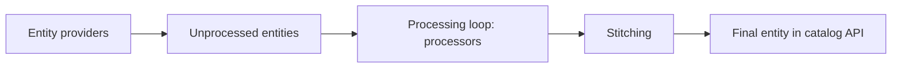

# 03 - Backstage Catalog

**Domain 3: Backstage Catalog (22%)**

Curriculum topics: understand how and why to use the Backstage Catalog; populate the catalog; using annotations; working with manually registered entity locations; troubleshooting entity ingestion; working with automated ingestion.

---

## Why a catalog

The Software Catalog is the part of Backstage that "manages all your software, including microservices, libraries, data pipelines, websites, and ML models." Each piece of software is an **entity** described by a YAML file that lives next to the code. The portal reads those files, so ownership and metadata are updated through pull requests and not through a separate admin screen.

---

## The descriptor format

Every entity has four root fields:

| Field | Meaning |
|---|---|
| `apiVersion` | `backstage.io/v1alpha1` for Backstage kinds (Template uses `backstage.io/v1beta2`) |
| `kind` | The entity type, such as `Component` |
| `metadata` | Required descriptive data |
| `spec` | Kind-specific data; structure varies by kind |

`metadata` fields: `name` (required, unique per kind in a namespace, 1 to 63 characters), `namespace` (defaults to `default`), `title`, `description`, `labels`, `annotations`, `tags` and `links`. The `backstage.io/` prefix is reserved for labels and annotations. `uid` is generated by the database.

A Component, adapted from the docs' structure:

```yaml
apiVersion: backstage.io/v1alpha1
kind: Component
metadata:
  name: ticket-service
  title: Ticket Service
  description: Handles event ticket issuance
  labels:
    team-tier: gold
  annotations:
    example.com/runbook: https://wiki.example.com/tickets
  tags:
    - go
  links:
    - url: https://dashboard.example.com
      title: Metrics
      type: dashboard
spec:
  type: service
  lifecycle: production
  owner: ticketing-team
  system: event-platform
  providesApis:
    - ticket-api
  consumesApis:
    - payments-api
  dependsOn:
    - resource:default/tickets-db
```

Component `spec`: `type`, `lifecycle` and `owner` are required. `type` is for example `service`, `website` or `library`; `lifecycle` is for example `experimental`, `production` or `deprecated`; `owner` is an entity reference, usually a Group or User. Optional: `system`, `subcomponentOf`, `providesApis`, `consumesApis`, `dependsOn`.

Other kinds: **Template** (scaffolder templates), **API**, **Group**, **User**, **Resource**, **System**, **Domain** and **Location**.

**[📖 Descriptor format](https://backstage.io/docs/features/software-catalog/descriptor-format/)** - envelope, metadata, kinds

---

## Annotations

Annotations are key/value strings that link an entity to outside systems or steer plugins. Well-known ones from the docs:

| Annotation | Meaning |
|---|---|
| `backstage.io/techdocs-ref` | Where the TechDocs source lives, usually a path relative to `catalog-info.yaml`, or an absolute URL |
| `backstage.io/source-location` | Points to the entity's source code; folder URLs should end with `/` |
| `backstage.io/managed-by-location` | Added by the catalog; where the entity was fetched from. Not written by hand |
| `backstage.io/managed-by-origin-location` | The location whose registration created the entity; differs when a location delegates to another |
| `backstage.io/view-url`, `backstage.io/edit-url` | Customize the links on the catalog page |
| `github.com/project-slug` | The GitHub repository as `<owner>/<repo>`; enables GitHub features |
| `backstage.io/orphan` | Set by the catalog (never by hand) to `"true"` when an entity has no active registered location |
| `backstage.io/source-template` | The scaffolder template used to create the entity |

`backstage.io/github-actions-id` is deprecated in favor of `github.com/project-slug`. Plugin annotations follow the plugin's own prefix (for example `sentry.io/project-slug`).

**[📖 Well-known annotations](https://backstage.io/docs/features/software-catalog/well-known-annotations/)** - the full list

---

## Populating the catalog: manually registered locations

A **location** is a pointer to where entity files live. Static locations go in `app-config.yaml`:

```yaml
catalog:
  locations:
    - type: url
      target: https://github.com/backstage/backstage/blob/master/packages/catalog-model/examples/components/artist-lookup-component.yaml
```

- `type: url` is handled by the built-in `UrlReaderProcessor`; reading GitHub files needs the GitHub integration.
- `type: file` is for local development, tests and example data only (paths are relative to the backend, typically `packages/backend/`).
- Locations from static config cannot be removed through the catalog locations API; remove them from configuration.

`catalog.rules` controls which kinds may be ingested. By default only `Component`, `API` and `Location` are allowed. Setting `catalog.rules` **replaces** those defaults, so list any you still want:

```yaml
catalog:
  rules:
    - allow: [Component, API, Location, Template]
```

Rules can also be set per location, and `rules: []` rejects all kinds. A common first-day surprise: a Template or Group file registers but never appears, because its kind was not allowed.

`processingInterval` sets how often processors revisit entities, as a duration object such as `{ minutes: 45 }`. It is a suggested minimum, and a very low value can exhaust rate limits on external systems.

**[📖 Catalog configuration](https://backstage.io/docs/features/software-catalog/configuration/)** - locations, rules, processing interval

---

## Automated ingestion

Registering locations one by one does not scale. **Entity providers** pull entities in from a source on a schedule. The GitHub discovery module scans an organization for descriptor files:

```bash
yarn --cwd packages/backend add @backstage/plugin-catalog-backend-module-github
```

```ts
backend.add(import('@backstage/plugin-catalog-backend'));
backend.add(import('@backstage/plugin-catalog-backend-module-github'));
```

```yaml
catalog:
  providers:
    github:
      providerId:
        organization: 'backstage'
        catalogPath: '/catalog-info.yaml'
        filters:
          branch: 'main'
          repository: '.*'
        schedule:
          frequency: { minutes: 30 }
          timeout: { minutes: 3 }
```

You also need a GitHub integration with a Personal Access Token (at least the `repo` scope) or a GitHub App (at least `Contents: Read-only`). Providers and processors differ: **providers supply entities** from external sources (configured under `catalog.providerOptions`), **processors read, parse, transform and validate** raw entity data (under `catalog.processorOptions`, default priority 20).

**[📖 GitHub discovery](https://backstage.io/docs/integrations/github/discovery/)** - module, config, token permissions

---

## How an entity moves through the catalog



*Providers feed unprocessed entities, processors validate and expand them, and the stitcher merges the result into the entity the catalog API exposes.*

From the life-of-an-entity page:

- **Ingestion:** providers store raw data as unprocessed entities. Two ship by default: user-registered locations and static config locations. "If there were no entity providers, no entities would ever enter the system."
- **Validation:** ingestion applies only coarse checks (such as requiring `kind` and `metadata.name`). Precise validation happens during processing.
- **Processing:** each entity has a next-run timestamp. Processors run in fixed steps and in registration order, adjustable with `catalog.processorOptions.<name>.priority` (lower runs earlier). Processing can create or update entities but cannot delete them.
- **Stitching:** merges the processed entity, its errors and its relations into the final entity and refreshes the search table. It runs only when the entity hash changes.
- **Orphaning:** when a parent stops emitting a child and nothing else references it, the child gets `backstage.io/orphan: 'true'`. The default `orphanStrategy` is delete; `keep` disables automatic cleanup.

---

## Troubleshooting entity ingestion

A checklist built from the lifecycle page:

1. **Does the entity appear at all?** Check the location is registered (static config or UI) and the kind is allowed by `catalog.rules`.
2. **Is there an error?** Errors surface as events from the catalog and as the entity's status field on its page when the `EntityProcessingErrorsPanel` is present. Errors do not cause orphaning, and processing continues.
3. **Is the entity marked orphan?** Look for `backstage.io/orphan: 'true'`; a parent stopped emitting it.
4. **Does a deleted entity come back?** A parent `Location` still references it, so it is recreated on the next processing pass. Remove it at the source.
5. **Is it slow?** Check `processingInterval`, provider schedules and rate limits, and watch the stitched entity count, because a large number can cause performance problems.
6. **Is the GitHub read failing?** Confirm the integration token scope or App permissions listed above.

**[📖 Life of an entity](https://backstage.io/docs/features/software-catalog/life-of-an-entity/)** - ingestion, processing, stitching, errors

---

## Key terms

- **Entity** - one cataloged item, described by a descriptor with apiVersion, kind, metadata and spec.
- **Component** - an entity kind for a piece of software such as a service, website or library.
- **Location** - an entity kind and a mechanism that points to where other entity files live.
- **System** - an entity kind that groups components and resources.
- **Domain** - an entity kind that groups systems sharing a bounded context.
- **catalog-info.yaml** - the conventional name of the descriptor file kept in a repository.
- **Annotation** - a key/value string on an entity that links it to external systems or configures plugins.
- **Entity provider** - a catalog component that supplies entities from an external source.
- **Processor** - a catalog component that reads, parses, transforms and validates entity data.
- **Stitching** - merging processed entity data, errors and relations into the final entity.
- **Orphan** - an entity with no active parent or registered location, marked `backstage.io/orphan: 'true'`.
- **catalog.rules** - the config that restricts which entity kinds may be ingested.
