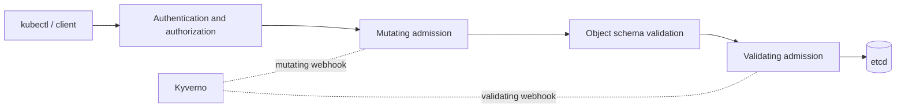

# 01 - Fundamentals of Kyverno

**Domain 1: Fundamentals of Kyverno (18%)**

Curriculum topics, in order: Kyverno Policies & Rules, YAML Manifests, Admission Controllers, OCI Images.

> **Version note (read this first).** The Kyverno docs read on 2026-11-07 mark `ClusterPolicy` and `Policy` (`kyverno.io/v1`) as deprecated as of Kyverno v1.19, with removal planned for v1.20, and point to CEL-based policy types (`ValidatingPolicy`, `MutatingPolicy`, `GeneratingPolicy`, `ImageValidatingPolicy`, `DeletingPolicy`) in `policies.kyverno.io/v1`. The KCA curriculum still lists the classic building blocks (preconditions, autogen, JSON patches, cleanup policies) next to CEL, so this guide teaches the classic `ClusterPolicy` model in depth and then the CEL types. Check which one the exam's Kyverno version uses before you book.

---

## What Kyverno is

Kyverno is a policy engine built for Kubernetes. The docs introduce it in one line: "Kyverno (Greek for 'govern') is a cloud native policy engine." What sets it apart from engines that use their own language is that **a Kyverno policy is a Kubernetes resource**. You write YAML, apply it with `kubectl`, store it in Git, and review it like any other manifest. You do not learn a separate policy language to get started.

What a policy can do, per the introduction page:

| Capability | What it means |
|---|---|
| **Validate** | Check a resource against rules and either block it or report it |
| **Mutate** | Change a resource on its way in (add a label, set a default) |
| **Generate** | Create new resources when something happens (a default NetworkPolicy for every new Namespace) |
| **Clean up** | Delete resources on a schedule or when a TTL label expires |
| **Verify images** | Check container image signatures and attestations for supply chain security |

**[📖 About Kyverno](https://kyverno.io/docs/introduction/)** - what Kyverno is and the capabilities it lists

---

## Policies and rules

A **policy** is the container. A **rule** is one unit of work inside it. A policy holds one or more rules under `spec.rules`, and each rule has:

1. a **name**,
2. a **match** block (which resources the rule looks at, with an optional **exclude**),
3. exactly one **rule type** body: `validate`, `mutate`, `generate` or `verifyImages`.

Classic policy kinds (`kyverno.io/v1`):

- `ClusterPolicy` - cluster-scoped; can match resources in any Namespace.
- `Policy` - namespaced; applies only inside its own Namespace.

Here is the smallest useful policy, taken from the Kyverno validate documentation. It requires a `purpose` label on every new Namespace.

```yaml
apiVersion: kyverno.io/v1
kind: ClusterPolicy
metadata:
  name: require-ns-purpose-label
spec:
  rules:
    - name: require-ns-purpose-label
      match:
        any:
          - resources:
              kinds:
                - Namespace
      validate:
        failureAction: Enforce
        message: 'You must have label `purpose` with value `production` set on all new namespaces.'
        pattern:
          metadata:
            labels:
              purpose: production
```

Read it top to bottom: "for every Namespace, enforce that `metadata.labels.purpose` is `production`, and show this message if not."

**Audit versus Enforce.** `Enforce` blocks a non-compliant resource at admission. `Audit` lets it through and records the violation in a policy report. The docs say the policy-level `spec.validationFailureAction` is deprecated and the action now belongs on the rule: `spec.rules[*].validate[*].failureAction`.

**[📖 Validate rules](https://kyverno.io/docs/policy-types/cluster-policy/validate/)** - failureAction, pattern, deny, foreach, CEL

---

## YAML manifests: what Kyverno reads

Kyverno matches against the **resource being admitted**, which is ordinary Kubernetes YAML. The curriculum tests whether you can read both the policy and the resource and say what happens. Three habits help:

1. **A pattern is an overlay.** The policy's `pattern` is a partial copy of the resource you want. Fields you write must exist and match. Fields you do not write are ignored.
2. **`match` is about identity, `pattern` is about content.** `match` picks the resource (kind, name, labels, namespace, user). `pattern` checks what is inside it.
3. **Lists are matched element by element.** A pattern for `spec.containers` is applied to every container unless you anchor it (more in note 05).

```yaml
# A resource that PASSES the policy above
apiVersion: v1
kind: Namespace
metadata:
  name: payments
  labels:
    purpose: production
```

```yaml
# A resource that is BLOCKED: label missing
apiVersion: v1
kind: Namespace
metadata:
  name: scratch
```

---

## Admission controllers

Kyverno works because Kubernetes lets outside services take part in admitting objects. The Kubernetes documentation defines the idea: "An admission controller is a piece of code that intercepts requests to the Kubernetes API server prior to persistence of the resource, but after the request is authenticated and authorized."



*A request is authenticated and authorized first, then mutated, then validated, then persisted. Kyverno plugs into both admission phases through webhooks.*

Facts to hold on to, all from the Kubernetes docs:

- Admission runs in **two phases**: mutating controllers first, validating controllers second. If any controller rejects the request in either phase, the whole request is rejected.
- Admission only applies to requests that **create, delete or modify** objects (and some custom verbs). It "cannot block requests to read (get, watch or list) objects."
- Two of the extension points are **MutatingAdmissionWebhook** and **ValidatingAdmissionWebhook**, which call external HTTP services. **MutatingAdmissionPolicy** and **ValidatingAdmissionPolicy** are the in-API, declarative alternative with no external call.

Per Kyverno's architecture page, Kyverno "receives validating and mutating admission webhook callbacks from the Kubernetes API server, applies matching policies, and either allows the request or rejects it." Its Webhook Controller "watches installed policies and configures the webhooks to request only the resources those policies match," so the API server does not call Kyverno for objects no policy cares about.

A practical consequence: a policy cannot stop something that was created **before** the policy existed. That is what background scans and policy reports are for (note 06).

**[📖 Admission controllers reference](https://kubernetes.io/docs/reference/access-authn-authz/admission-controllers/)** - the two phases, dynamic webhooks, reads bypass admission

**[📖 How Kyverno works](https://kyverno.io/docs/introduction/how-kyverno-works/)** - webhook, engine and controllers

### Kyverno's controllers

Each runs as its own Deployment:

| Controller | Job |
|---|---|
| **Admission** | Serves the webhooks and runs the engine on live requests |
| **Background** | Handles `generate` and mutate-existing policies by reconciling `UpdateRequest` resources |
| **Reports** | Builds PolicyReports from admission reports and background scan reports |
| **Cleanup** | Runs cleanup policies and TTL deletion |

The architecture page also lists a **Cert Renewer** that renews the webhook certificates, stored as Kubernetes Secrets.

---

## OCI images

Two reasons images appear in a Kyverno curriculum: policies **inspect** image references, and policies **verify** images.

An image reference is `registry/path/name:tag` or `registry/path/name@sha256:digest`. Kyverno exposes the parts in the `images` variable for each container type, with fields `registry`, `path`, `name`, `tag`, `digest`, `reference` and `referenceWithTag`. For example, `{{images.containers.nginx.registry}}`.

A **tag** can be moved to point at a different image later; a **digest** cannot. That is why `verifyImages` defaults to `mutateDigest: true`, which rewrites tags to digests so the reference becomes immutable. Signatures and attestations are stored alongside the image in the registry, and `verifyImages` checks them (note 05).

```yaml
# Block the mutable :latest tag, using the image parts exposed to the rule
validate:
  failureAction: Enforce
  message: "Images must not use the ':latest' tag."
  pattern:
    spec:
      containers:
        - image: "!*:latest"
```

*The `!` operator negates a pattern value. Not run: no cluster or Kyverno CLI was available when this guide was written.*

**[📖 Variables](https://kyverno.io/docs/policy-types/cluster-policy/variables/)** - the `images` variable and its fields

**[📖 verifyImages rules](https://kyverno.io/docs/policy-types/cluster-policy/verify-images/)** - signatures, attestations, digests

---

## Key terms

- **Policy engine** - software that evaluates rules against resources and allows, changes, creates or reports.
- **ClusterPolicy** - the cluster-scoped Kyverno policy kind in `kyverno.io/v1` (deprecated as of v1.19 per the docs).
- **Policy** - the namespaced Kyverno policy kind in `kyverno.io/v1`.
- **Rule** - one named unit in a policy, with a match block and one of validate, mutate, generate or verifyImages.
- **Audit** - a failure action that allows non-compliant resources and records the violation in a report.
- **Enforce** - a failure action that blocks non-compliant resources at admission.
- **Admission controller** - code in the API server that intercepts create, update and delete requests after authorization and before persistence.
- **Mutating admission** - the first admission phase, where requests can be changed.
- **Validating admission** - the second admission phase, where requests are accepted or rejected without change.
- **Webhook** - an HTTP callback the API server makes to an external service during admission.
- **Digest** - an immutable content hash of an image, as opposed to a movable tag.
