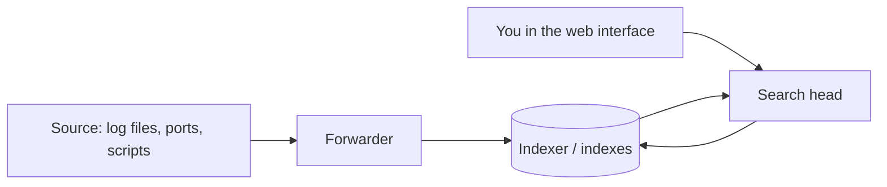

# 01 - Splunk Basics and Basic Searching

**Blueprint domains 1.0 Splunk Basics (5%) and 2.0 Basic Searching (22%)**

Blueprint topics: Splunk components, the uses of Splunk, apps, user settings, basic navigation; running basic searches, setting the time range, reading search results, refining searches, the timeline, working with events, controlling a search job, saving results.

Commands and screens in this note come from the Splunk documentation and the blueprint. They were not run on an instance for this guide, so treat the exact menu wording as something to confirm in your own trial or free instance.

---

## What Splunk is for

Splunk turns machine data into something you can ask questions of. Machine data is the stream of text that software and hardware produce without anyone asking: web server access logs, application error logs, operating system events, network device messages, cloud audit trails, metrics from a sensor. Nobody reads that text line by line. The reason to collect it in one place is that when something breaks, or when someone asks "how many people hit the checkout page last Tuesday", the answer is already sitting in those files.

The blueprint calls this "understand the uses of Splunk", and the shape of the answer is the same every time. Splunk **collects** data from many places, **indexes** it so it can be searched quickly, and gives you a **search language** and a **web interface** to ask questions, turn the answers into reports and dashboards, and be told automatically when something looks wrong. The common use families are IT operations (what is broken and why), security (who did what, and does it look malicious) and business analytics (what are users doing). The exam is entry level, so you are not asked to design any of that. You are asked to use it.

**[📖 What is Splunk Enterprise?](https://docs.splunk.com/Documentation/Splunk/latest/Overview/AboutSplunkEnterprise)** - the official overview of the product

---

## The components, in the order data moves

Data has to travel from where it is born to where you search it. Learn the components as a pipeline, because the exam asks you to match a component to its job.

A **forwarder** is a lightweight program installed on the machine that produces data. Its job is to read files or listen on ports and send what it finds onward. The common kind, the universal forwarder, does almost no processing. It is a courier.

An **indexer** receives data, parses it, and writes it to disk in **indexes**. An index is the repository where Splunk stores data in a searchable form. The act of storing is called indexing, and it is also where Splunk breaks the stream into individual **events** and attaches the metadata that will make searching fast. Data that has not been indexed cannot be searched.

A **search head** is the component you actually sit in front of. It hosts the web interface, takes the search you type, sends it to the indexers that hold the data, and gathers and presents the results. In a very small installation, a single instance does all three jobs. In a large one they are separate machines, and a search head may query many indexers at once.

A useful way to remember it: forwarders **forward**, indexers **index**, search heads **search**. The exam writes questions that are only these three verbs dressed up.



The diagram shows data flowing left to right from the source through a forwarder into the indexer, while your searches come in from the search head and read from the indexer. Splunk Cloud Platform is Splunk operating the indexing and search tiers for you, so the same ideas apply while someone else runs the servers.

**[📖 Components of a Splunk Enterprise deployment](https://docs.splunk.com/Documentation/Splunk/latest/Overview/Aboutthesplunkplatform)** - forwarders, indexers and search heads

---

## Apps

An **app** in Splunk is a packaged collection of configuration and content that gives you a ready-made workspace for a particular job. An app might hold dashboards, saved searches, field definitions, lookup files and a navigation bar, all arranged for something like monitoring a web server or doing security investigations. The built-in **Search & Reporting** app is where most of this exam lives: it is the app with the search bar, the reports, the alerts and the dashboards.

Two things to hold on to. First, apps are how Splunk is extended, so the question "what do you install to get content for a specific technology" has the answer "an app" (or an add-on, which is the data-input and parsing flavor of the same idea, usually without a user interface). Second, apps control **visibility and ownership** of the objects you create. When you save a report you are saving it inside a particular app, and what other people can see depends on the permissions you give it. That idea returns in the notes on reports and dashboards.

You switch apps from the **Apps** menu at the top left of the interface, and each app has its own navigation bar.

---

## User settings and navigation

Splunk is a role-based system. The things you can see and do depend on the **role** you were assigned, and the role carries capabilities and access to specific indexes. A user who cannot search a particular index will simply get no results from it, which is worth remembering when a search that works for a colleague returns nothing for you.

Under your name in the top bar you can reach **Account Settings**, where you change things that are personal to you: your full name, your time zone, your default app, and your password. The **default app** decides which app you land in after login. Your **time zone** setting matters more than it looks, because Splunk displays event time according to it, and a mismatch is a common cause of "my events are in the wrong hour".

The top bar also holds **Messages** (system warnings), **Settings** (where knowledge objects like lookups and fields are managed) and **Activity** (which shows the jobs you have run). On a typical landing page the **Search & Reporting** app opens to a search bar, panels that list recent activity, and links to documentation and tutorials. You are expected to know where the **Search** page, **Reports**, **Alerts** and **Dashboards** tabs are in that app's navigation bar.

**[📖 Search Tutorial: Navigating Splunk Web](https://docs.splunk.com/Documentation/Splunk/latest/SearchTutorial/NavigatingSplunk)** - the interface tour

---

## Anatomy of a search

A search is a question typed into the **search bar**. At its simplest it is just a word:

```
error
```

That returns every event that contains the term error. Because events are chunks of text, the first idea of Splunk searching is that **terms are matched against the raw text of the event**. Search terms are not case sensitive for keywords, which surprises people who come from `grep`. Field values in comparisons, covered in the next note, have their own rules.

The next idea is **boolean logic**. Terms placed next to each other are joined with an implied `AND`, so `error login` finds events with both words. You can write `OR` and `NOT` explicitly, and they must be uppercase. Parentheses group:

```
error (login OR logout) NOT debug
```

The order of operations is that `NOT` is evaluated first, then `OR`, then `AND`, which is why parentheses are the safe habit. Wildcards use an asterisk, so `fail*` matches fail, failed, failure and failing. A phrase containing spaces goes in quotation marks: `"permission denied"`.

The practical lesson is that **a good search is as specific as you can make it, as early as you can make it.** The more precise the first terms, the less data Splunk has to carry into the next step, and the faster everything runs. A search of just `*` over a wide time range is the slowest and least useful search there is.

**[📖 Search Manual: Basic searches](https://docs.splunk.com/Documentation/Splunk/latest/Search/Aboutsearching)** - terms, booleans and wildcards

---

## The time range picker

Every search runs over a window of time, and the **time range picker** to the right of the search bar sets it. This control matters on the exam because time is the single most effective filter you have. Events in Splunk are stored with a timestamp and arranged by time on disk, so narrowing the range lets Splunk skip huge amounts of data.

The picker offers several kinds of range. **Presets** are the ready choices such as the last 15 minutes, last 24 hours or last 7 days. **Relative** lets you say "from some time ago to now" or to some time ago. **Real-time** windows keep sliding forward as data arrives. **Date range** and **Date & time range** let you give fixed calendar boundaries. **Advanced** lets you type time modifiers. The default for a new search is usually a short window, and if a search returns nothing it is worth checking whether the range simply does not reach the time the events happened.

Time modifiers use a compact syntax built from `earliest` and `latest`. A negative offset reaches into the past, and the unit letters are seconds, minutes, hours, days, weeks and months. The snap-to feature rounds to a boundary:

```
earliest=-24h latest=now
earliest=-7d@d latest=@d
```

The second example means from seven days ago snapped back to the start of that day, until the start of today. The `@` is the snap. Typing these into the search itself overrides the picker, which is a good thing to know when a saved search seems to ignore the picker.

**[📖 Search Manual: Specify time modifiers in your search](https://docs.splunk.com/Documentation/Splunk/latest/Search/Specifytimemodifiersinyoursearch)** - earliest, latest and snapping

---

## Reading the search results page

After you run a search the page rearranges itself into a layout you should recognize on sight. Under the search bar is a **job status bar** that shows the number of events matched and the buttons to pause, stop, share, print and export. Under that are tabs. The **Events** tab lists the raw events. The **Patterns** tab groups events that look alike. The **Statistics** tab shows tabular results, and it only becomes useful once your search includes a transforming command. The **Visualization** tab charts those statistics.

Within the Events tab, three things stand out. The **timeline** above the events is a bar chart of how many events matched in each slice of the time range. The **fields sidebar** at the left lists fields found in the results, split into **selected fields** (shown with each event) and **interesting fields** (those appearing in a good share of the events). And the **event list** itself shows each event with its time, its raw text and its selected fields.

You can display the event list in three formats: **List** shows each event on its own with the field values you can expand, **Raw** shows just the raw text, and **Table** shows rows and columns. You can also set how many events appear per page.

**Highlighting** helps your eyes. Search terms are highlighted in the results so you can see why an event matched. Clicking a term, a field value, or a timestamp in the event offers choices for adding to or excluding from the search, which is how you refine a search without typing.

**[📖 Search Tutorial: Start searching](https://docs.splunk.com/Documentation/Splunk/latest/SearchTutorial/Startsearching)** - the results page, line by line

---

## Refining searches

Refinement is the loop of reading results, deciding what to keep, and tightening the search. There are three levers.

The first is to **add more terms or field comparisons**. If `error` gives too much, `error login failed` gives less. The second is to **exclude** with `NOT`, for example `error NOT timeout`, which drops every event with the term timeout. The third is to **narrow the time range** to just the window you care about.

The interface supports the loop with clicks. Choosing a value in the fields sidebar offers to add it to the search or exclude it. Clicking an event's term gives you the same choices. Both add the corresponding terms to the search bar for you, and the search reruns, so you learn the syntax by watching what the interface writes. The exam likes this: a question may describe a user clicking a value and ask what happens to the search.

---

## The timeline

The timeline is more than decoration. It is a **second way to set the time range** after the fact. If you see a spike in the bars, you can click one bar to zoom into that slice, or drag across a stretch of bars to select a range, and then choose to zoom in or to zoom out. **Zoom to selection** re-runs the search on the selected range and keeps the work in the same job window where possible; **Deselect** removes the selection and goes back. Hovering a bar shows how many events fell in it.

Two details to keep. The timeline shows when events occurred, not when they were indexed, so a late-arriving batch shows up where the events were stamped. And the scale of the bars changes with the range: a day looks like hours, a week like days, and so on.

**[📖 Search Tutorial: Use the timeline](https://docs.splunk.com/Documentation/Splunk/latest/SearchTutorial/Usethetimeline)** - zoom and select

---

## Working with events

An event is a single record, in practice usually one log line or one multi-line entry. In the Events tab you can **expand** an event to see its fields in a list, each with a value and an action menu. The action menu on a field lets you add the value to the search, exclude it, or open a new search with it. The small arrow at the left of an event is what opens it.

Every event carries a few default fields that Splunk adds when indexing: **host** (the machine it came from), **source** (the file or input it came from), **sourcetype** (the format or type of data) and **index** (where it is stored), along with **_time** and **_raw**. The interesting ones for this exam are the first three, which you will see in the selected fields by default. Think of them as the answer to "where did this come from, and what kind of data is it".

You can also add **event actions**, such as extracting fields or building an event type, and copy events to the clipboard. The key point: working with events is mostly about expanding, reading and clicking.

---

## Controlling a search job

Each time you run a search, Splunk creates a **search job**. The job runs, produces results and then lingers for a time so you can come back to it.

Controls on the job status bar let you manage it. **Pause** halts a running job so you can look at what it found so far. **Stop** ends it and keeps the partial results. **Cancel** or **Delete** removes it. **Send job to background** lets a long search keep running while you do something else. **Inspect** shows how the job performed: how long each stage took, how many events were scanned and matched. The **Job** menu also offers **Share**, which extends how long the results are kept and makes them readable by others.

Jobs have a **lifetime**. A job's results are retained for a limited time, and the exam tests the difference between the two standard settings. A regular job's results are kept for a shorter window; a **shared** job's results are kept longer and are visible to other users with the right permission. The exact retention times are in the Splunk docs, so confirm them there instead of memorizing a number from a study site. You can find your past jobs on the **Activity** > **Jobs** page.

Search **mode** is the other dial on a job. **Fast mode** emphasizes speed and discovers fewer fields. **Smart mode** (the default) adjusts to the kind of search. **Verbose mode** returns all event data and all fields, at a cost. If a field you expect is missing, verbose mode is the first thing to try.

**[📖 Search Manual: About jobs and job management](https://docs.splunk.com/Documentation/Splunk/latest/Search/Aboutjobsandjobmanagement)** - lifetimes, sharing and inspection

---

## Saving search results

When a search is worth keeping there are several ways to preserve it, and the exam wants you to pick the right one.

**Save As > Report** saves the search itself, so that whenever you open it, Splunk re-runs the question. This is the most common choice and is the subject of the reports note. **Save As > Alert** turns the search into something that fires when a condition is met. **Save As > Dashboard Panel** puts it on a dashboard. **Save As > Event Type** names a class of events.

You can also **export** results of a finished search as CSV, XML or JSON through the **Export** button. That saves data, not the question. Exporting hands someone a snapshot; saving a report hands them a live question.

The difference between a saved search and exported results is a good example of how this exam is written: the words describe a goal ("send the numbers to a colleague who does not use Splunk"), and the right answer is the feature whose purpose matches it.

---

## Key terms

- **Forwarder** - a component installed on a data source that collects data and sends it to an indexer.
- **Indexer** - the component that processes incoming data and stores it in indexes so it can be searched.
- **Search head** - the component that hosts the web interface, takes searches and gathers results from indexers.
- **Index** - a repository where Splunk stores data in a searchable form.
- **Event** - a single record of machine data, usually one log entry, with a timestamp.
- **App** - a packaged set of configuration and content, such as dashboards and searches, for a particular purpose.
- **Search & Reporting** - the default app that holds the search bar, reports, alerts and dashboards.
- **Role** - a set of capabilities and index access assigned to a user.
- **Time range picker** - the control beside the search bar that sets the window of time a search covers.
- **Timeline** - the bar chart above the events showing how many matched in each slice of time.
- **Fields sidebar** - the panel listing fields found in search results, split into selected and interesting.
- **Search job** - the process Splunk creates each time a search runs, which can be paused, stopped, shared or inspected.
- **Search mode** - the setting (fast, smart or verbose) that trades speed against how many fields are discovered.
- **host** - a default field naming the machine that produced the event.
- **source** - a default field naming the file, port or script an event came from.
- **sourcetype** - a default field naming the format or type of the data.
- **Wildcard** - an asterisk in a search term that matches any run of characters.
- **Snap to** - the `@` time modifier syntax that rounds a time boundary to the start of a unit.

---

## What to take into the exam

If a question describes a **role in the data pipeline**, map it to forwarder, indexer or search head. If it describes **narrowing a search**, think specific terms first, then time range, then field comparisons. If it describes **keeping something**, decide whether the person needs the question (a report) or the answer (an export). And if a search gives no results, check the time range and the role's index access before blaming the data.
