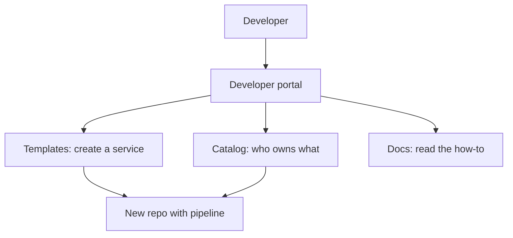

# Backstage and Developer Portals

> **8-minute read. Assumes you've read [Platform engineering explained](./platform-engineering-explained.md).**

## The one-line answer

A developer portal is the front door to an internal platform: one web page where engineers find services, create new ones from templates and read their docs. Backstage is the best-known open-source framework for building one.

## The problem it solves

Once a company has dozens of services, nobody knows who owns what, where the docs are, or how to start a new service correctly. Answers live in wiki pages, chat threads and one person's head. A portal gathers them in one place, so the [golden paths](./platform-engineering-explained.md) a platform team builds are actually discoverable.

## What Backstage is

Backstage describes itself as "an open source framework for building developer portals." It is a CNCF Incubation project, after graduating from Sandbox, and the project site credits Spotify ("Made with love at Spotify").

**[📖 What is Backstage?](https://backstage.io/docs/overview/what-is-backstage)** - the project overview

It is a framework, not a finished product. You assemble a portal from its parts and run it yourself.

Core features from the overview:

| Feature | What it does |
|---|---|
| **Software Catalog** | Tracks all your software (microservices, libraries, data pipelines, websites, ML models) with owners and metadata |
| **Software Templates** | Spins up new projects quickly and standardizes tooling with your organization's best practices |
| **TechDocs** | "Docs like code": documentation lives with the code and is easy to create, maintain, find and use |
| **Plugins** | An ecosystem of open-source plugins to extend and customize the portal |

The portal is a window onto the platform: the catalog finds things, templates create them, docs explain them.

## Portal versus platform

A portal is not the platform. The platform is the pipelines, clusters, policies and automation. The portal is the interface to them. A portal on top of nothing is a nicer wiki. A good platform with no portal still works but is harder to find and adopt.

## Build or buy

| Choice | Fits when | Cost |
|---|---|---|
| **Run Backstage yourself** | You have a platform team with web engineers | Real engineering time: it is a framework you maintain and upgrade |
| **A hosted or commercial portal** | You want the idea without owning the codebase | Subscription and less flexibility |
| **A simple catalog in a repo** | Fewer than about ten services | Almost none; do this first |

The sizes in the last column are judgement, not measured numbers. The usual failure is starting a Backstage rollout with no platform team to own it.

## Common mistakes

- Building the portal before the golden paths exist, so there is nothing worth finding.
- Treating the catalog as a one-time import. Without owners updating it, it goes stale in months.
- Measuring success by pages built instead of by whether teams use it.

## How exams test it

The Linux Foundation's [Certified Cloud Native Platform Engineering Associate (CNPA)](../../exams/kubernetes/cnpa/README.md) covers internal developer platforms; expect questions that map "service catalog", "templates" and "docs as code" to a developer portal.

## Go deeper

- **[📖 What is Backstage?](https://backstage.io/docs/overview/what-is-backstage)** - catalog, templates, TechDocs, plugins

## What to look at next

- **[Platform engineering explained](./platform-engineering-explained.md)** - the platform the portal fronts
- **[GitOps explained](./gitops-explained.md)** - the deploy engine behind many templates
- **[CI/CD explained](./cicd-explained.md)** - the pipelines a template wires up

## Check yourself

Try these before you move on. Each answer is collapsed; click it to check yourself.

1. Name the four core features of Backstage listed on the page.

   

   
Answer

   Software Catalog, Software Templates, TechDocs and Plugins. See: [What Backstage is](#what-backstage-is)

   

2. What is the difference between a developer portal and a platform?

   

   
Answer

   The platform is the pipelines, clusters, policies and automation. The portal is only the interface to them. See: [Portal versus platform](#portal-versus-platform)

   

3. Why does a software catalog that was imported once tend to go stale?

   

   
Answer

   Without owners updating it, it goes stale within months. See: [Common mistakes](#common-mistakes)

   

4. A company has fewer than about ten services. Which option does the page suggest first?

   

   
Answer

   A simple catalog in a repo, which costs almost nothing. See: [Build or buy](#build-or-buy)

   

