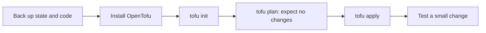

# OpenTofu vs Terraform

> **8-minute read. Assumes you've read [Terraform explained](./terraform-explained.md).**

## The one-line answer

OpenTofu is a community fork of Terraform that stays open source under the Linux Foundation. For everyday work the two feel almost the same; the command is `tofu` instead of `terraform`, and the choice is mostly about licensing, governance and a few features that differ.

## How the fork happened

HashiCorp moved Terraform from an open-source license to the Business Source License (BUSL). The OpenTofu FAQ says the new terms are ambiguous for companies and developers, and that the fork was started by Gruntwork, Spacelift, Harness, Env0, Scalr and others. The project now sits under the Linux Foundation and says it will always stay open source.

**[📖 OpenTofu FAQ](https://opentofu.org/faq/)** - why it exists, compatibility, governance

## What stays the same

- **The language.** The FAQ says the project aims to keep feature parity with Terraform for future releases, and the migration page says most Terraform code should work without changes.
- **Providers.** It works with current Terraform providers, but pulls them from its own registry.
- **State.** The FAQ says OpenTofu works with existing state files up to those created by Terraform 1.5.x.

Newer Terraform releases may behave differently, so test on your own code rather than assuming.

## What differs

| Topic | Terraform | OpenTofu |
|---|---|---|
| Command | `terraform` | `tofu` |
| Governance | HashiCorp product | Linux Foundation project |
| Registry | Terraform Registry | OpenTofu registry |
| State encryption | Not covered here | Built in (see below) |

OpenTofu documents client-side **state encryption**. State files often hold secrets, so this is a real reason to switch for some teams. Below is the passphrase example from the OpenTofu docs, copied as shown there (not run here, because `tofu` is not installed on this machine):

```hcl
variable "passphrase" {
  # Change passphrase to be at least 16 characters long:
  default   = "changeme!"
  sensitive = true
}

terraform {
  encryption {
    key_provider "pbkdf2" "my_key_provider_name" {
      passphrase = var.passphrase
    }
    method "aes_gcm" "my_method_name" {
      keys = key_provider.pbkdf2.my_key_provider_name
    }
    state {
      method = method.aes_gcm.my_method_name
      # enforced = true
    }
  }
}
```

Do not hard-code a real passphrase as a default. The docs also warn not to rename the key provider or method later, because the encrypted data stores metadata tied to those names.

**[📖 OpenTofu state encryption](https://opentofu.org/docs/language/state/encryption/)** - full options

## Moving over

The migration page gives a safe, reversible path:



Back up first, then init, plan and apply; a plan that shows unexpected changes means stop and investigate.

Cautions from the guide: do not apply if the plan shows unexpected changes, and setups that share data through `terraform_remote_state` need extra care. To roll back, stop using OpenTofu, restore backups if state changed, then run `terraform init` and `terraform plan`.

**[📖 Migrating to OpenTofu](https://opentofu.org/docs/intro/migration/migration-guide/)** - the steps

## Which should you pick?

- **Your company already pays for HCP Terraform or Terraform Enterprise:** stay on Terraform.
- **You need an open-source licence for legal or policy reasons, or want state encryption:** look at OpenTofu.
- **You are studying for HashiCorp's Terraform Associate:** learn Terraform; the exam is about Terraform. The skills carry over to OpenTofu.
- **Starting fresh, no strong constraint:** either works. Pick one and keep the whole team on it.

## Common mistakes

- Mixing `terraform` and `tofu` on one state without a plan. Pick one per project.
- Assuming a fork is drop-in forever. Features can diverge.
- Skipping the state backup.

## How exams test it

Terraform certification content is about Terraform itself. OpenTofu is background knowledge: expect it in discussion and interviews, not on the exam.

## Go deeper

- **[📖 OpenTofu FAQ](https://opentofu.org/faq/)**
- **[📖 Migrating to OpenTofu](https://opentofu.org/docs/intro/migration/migration-guide/)**

## What to look at next

- **[Terraform explained](./terraform-explained.md)** - the shared language
- **[Infrastructure as code explained](./infrastructure-as-code-explained.md)** - why state exists
