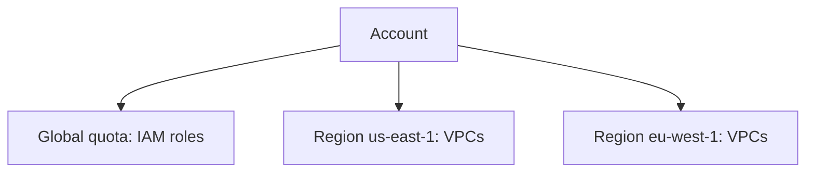

# Service Quotas and Limits

> **7-minute read. Assumes you've read [Regions and availability zones](./regions-and-availability-zones.md).**

## The one-line answer

Every cloud caps how much of each thing an account can use: instances, IP addresses, API calls per second. Hit a cap and creation fails with an error. Most caps can be raised by request, but not instantly, so find out before launch day.

## Why limits exist

Providers set defaults to stop abuse and accidental over-spend, and to protect shared capacity. AWS calls them quotas, also called limits: "the maximum values for the resources, actions, and items in your AWS account". Each service defines its quotas and sets default values.

**[📖 What is Service Quotas?](https://docs.aws.amazon.com/servicequotas/latest/userguide/intro.html)** - AWS's central quota service

## Two kinds of limit

| Kind | Meaning | Example |
|---|---|---|
| **Capacity (allocation)** | How much you can hold at once | VPCs per Region, IAM roles per account |
| **Rate** | How fast you can use it | API requests per second |

Google Cloud uses these two names. Its allocation quotas limit how much of a resource you can hold, and you free room by deleting unused resources. Rate quotas limit speed and reset on their own: per-day quotas reset at midnight Pacific Time.

**[📖 Cloud Quotas overview](https://docs.cloud.google.com/docs/quotas/overview)** - Google Cloud's quota types

## Scope matters

An AWS quota can apply per account or per Region. The docs give IAM roles per account and VPCs per Region as examples. Raising a quota in one Region does not raise it in another. A global quota applies at account level in all Regions, and you request an increase from a specific Region (US East, N. Virginia in the public partition).



Account-wide quotas are counted once; Regional quotas are counted separately in each Region.

## AWS terms

From the AWS terminology list:

- **Default value:** the initial value set by AWS.
- **Applied quota:** the updated value after an increase.
- **Adjustable:** whether it can be increased at all. Check the Adjustable column in the console.
- **Utilization:** percent of the quota in use. 150 used of 200 is 75 percent.

## Asking for more

In the console, pick the service and quota, then choose Request quota increase. AWS says increases take time to review and process, and support may approve, deny or partially approve. You can also use the API or the CLI. This example is from the AWS CLI documentation, where quota `L-20F13EBD` is "Running Dedicated c5n Hosts" (not run here: it files a real request in a real account):

```bash
aws service-quotas request-service-quota-increase \
  --service-code ec2 --quota-code L-20F13EBD --desired-value 2
```

Then check on it with `aws service-quotas get-requested-service-quota-change --request-id <id>`.

**[📖 Service Quotas CLI examples](https://docs.aws.amazon.com/cli/latest/userguide/cli_service-quotas_code_examples.html)** - request and status commands

Google Cloud works similarly: you request a quota adjustment, most requests are evaluated automatically and some go to human review, and a higher quota may cost more. Its quota adjuster can request increases for you as usage nears the limit.

## Watching for the wall

- **View utilization** in Service Quotas, once the account has been active for a while.
- **Automatic management:** AWS says it can monitor usage and notify you before you run out.
- **Alarm on it yourself** for the quotas your system actually depends on.

## A worked example

A team plans a launch needing 400 vCPUs in a new Region. The new Region's default quota is below the plan, so the first scale-out fails with a quota error at 2 a.m. The fix is a request filed days earlier. Rule of thumb: before any launch, load test, or Region expansion, list the quotas the plan touches, compare to utilization, and file increases a week ahead. "A week" is a safe habit, not a documented turnaround time.

## Common mistakes

- Finding quotas during an outage.
- Raising the quota in one Region and forgetting the DR Region. A failover that cannot launch instances is not a failover; see [Disaster recovery](./disaster-recovery-rpo-rto.md).
- Confusing quotas with throttling: you may be under the quota and still throttled by a burst.
- Treating a quota as a cost control. It is a safety rail, not a budget.

## How exams test it

- "Launch fails with a limit error, what do you do?" -> request an increase through Service Quotas.
- "DR region must be able to scale up" -> pre-raise quotas there.
- "Alert before a limit is reached" -> monitor utilization.

## Go deeper

- **[📖 What is Service Quotas?](https://docs.aws.amazon.com/servicequotas/latest/userguide/intro.html)**
- **[📖 Cloud Quotas overview](https://docs.cloud.google.com/docs/quotas/overview)**

## What to look at next

- **[Disaster recovery](./disaster-recovery-rpo-rto.md)** - quotas in the standby Region
- **[Autoscaling explained](./autoscaling-explained.md)** - scaling stops at the quota
- **[Cloud cost basics](./cloud-cost-basics.md)**

## Check yourself

Try these before you move on. Each answer is collapsed; click it to check yourself.

1. What is the difference between a capacity (allocation) quota and a rate quota?

    <details>
    <summary>Answer</summary>
    A capacity quota limits how much you can hold at once, such as VPCs per Region. A rate quota limits how fast you can use something, such as API requests per second. See: <a href="#two-kinds-of-limit">Two kinds of limit</a>
    </details>

2. You raised a VPC quota in us-east-1. Does that raise it in eu-west-1?

    <details>
    <summary>Answer</summary>
    No. Regional quotas are counted separately in each Region, and raising one does not raise it in another. See: <a href="#scope-matters">Scope matters</a>
    </details>

3. Why is raising the quota only in the primary Region a problem for disaster recovery?

    <details>
    <summary>Answer</summary>
    A failover that cannot launch instances is not a failover. The DR Region needs its quotas raised too. See: <a href="#common-mistakes">Common mistakes</a>
    </details>

4. A utilization of 150 used out of a 200 quota is what percent?

    <details>
    <summary>Answer</summary>
    75 percent. See: <a href="#aws-terms">AWS terms</a>
    </details>
