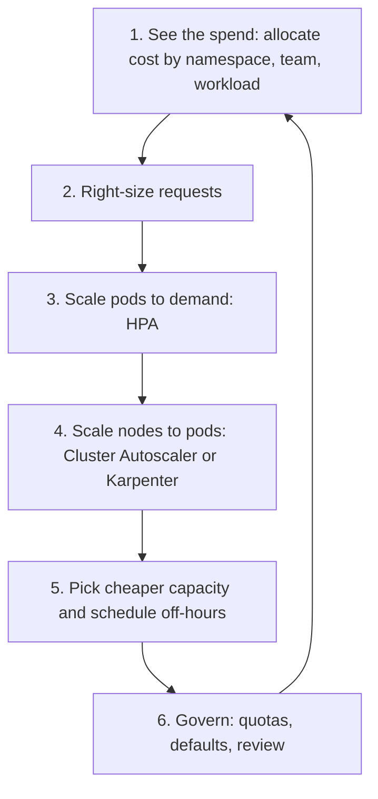

# Kubernetes Cost Optimization

## Overview

Kubernetes cost is mostly **node cost**: you pay for the machines, and the cluster decides how well they are packed. This guide covers the levers that matter, from the Kubernetes, Karpenter and OpenCost documentation. It gives no prices; use your cloud's pricing pages and the per-cloud guides: [AWS](./aws-cost-optimization.md), [Azure](./azure-cost-optimization.md), [GCP](./gcp-cost-optimization.md), and [FinOps principles](./finops-principles.md).

The Kubernetes docs put the goal plainly: ensure all schedulable pods run "whilst keeping the cost of the cluster as low as possible", and treat overall node utilization as a proxy for how cost-effective the cluster is. They add that correctly setting Pod resource requests is as important to cost-effectiveness as optimizing node utilization.

[**📖 Kubernetes - Node autoscaling**](https://kubernetes.io/docs/concepts/cluster-administration/node-autoscaling/) - provisioning, consolidation, and the cost framing.



*Cost work is a loop: measure, shrink requests, scale pods, scale nodes, then govern.*

---

## 1. See the spend

You cannot cut what you cannot attribute. OpenCost describes itself as "a vendor-neutral open source project for measuring and allocating cloud infrastructure and container costs", with real-time monitoring, showback and chargeback, and optional cloud billing integration for more accurate results.

- Allocate by namespace, label, team and workload.
- Standardize labels (team, service, environment) and enforce them at admission. Unlabelled spend is shared overhead nobody owns.
- Watch **idle cost**: capacity you pay for but no request uses.

Kubecost is a commercial product built around the same allocation ideas. This guide did not fetch Kubecost's documentation, so check its current features and licensing on its own site before comparing.

[**📖 OpenCost documentation**](https://opencost.io/docs/) - overview, installation guide and Prometheus configuration. The page fetched does not state whether Prometheus is required or whether OpenCost is a CNCF project; confirm in the installation guide.

---

## 2. Right-size requests and limits

The scheduler places Pods using **requests**. The kubelet enforces **limits**. Per the docs, the kubelet also reserves at least the request amount for that container.

```yaml
resources:
  requests:
    cpu: "250m"
    memory: "256Mi"
  limits:
    memory: "512Mi"
```

| Mistake | Cost effect |
|---|---|
| Requests far above real usage | Nodes look full while CPU sits idle; you pay for empty capacity |
| Requests too low | Pods packed too tight; throttling, evictions, and retries cost more later |
| No requests at all | BestEffort QoS: first to be evicted, and HPA CPU utilization is undefined |

Facts to rely on, from the Kubernetes docs:
- CPU limits are enforced by throttling; memory limits by OOM kills, reactively.
- If you set a limit but no request, Kubernetes uses the limit as the request.
- QoS classes: Guaranteed (requests equal limits for CPU and memory in every container), Burstable, BestEffort. Under node pressure BestEffort is evicted first.

How to size: observe real usage over a representative period (including peaks), set requests near typical usage with headroom, and revisit regularly. Check live usage with `kubectl top pod -n NAMESPACE` (needs Metrics Server).

### Vertical Pod Autoscaler (VPA)
VPA adjusts requests to match actual usage. It is a custom resource that "must be installed separately", unlike HPA. Recommendations live in `.status.recommendation` (target, lower bound, upper bound). The `updateMode` values include `Off` (recommendations only), `Initial` (set requests only at Pod creation), `Recreate`, `InPlaceOrRecreate` and `InPlace`. Starting with `Off` is a safe way to get right-sizing data without evictions. Eviction-based updates recreate Pods and respect PodDisruptionBudgets.

```yaml
apiVersion: autoscaling.k8s.io/v1
kind: VerticalPodAutoscaler
metadata:
  name: my-app-vpa
spec:
  targetRef:
    apiVersion: "apps/v1"
    kind: Deployment
    name: my-app
  updatePolicy:
    updateMode: "Off"
```

The fetched page was truncated before the details of the `Recreate`, `InPlace` and `Auto` modes, so read the full page before relying on them. Do not run VPA and HPA on the same metric for the same workload without reading the docs on how they interact (not covered by the pages fetched here).

[**📖 Kubernetes - Resource management for Pods and containers**](https://kubernetes.io/docs/concepts/configuration/manage-resources-containers/) - requests, limits, enforcement.
[**📖 Kubernetes - Pod QoS classes**](https://kubernetes.io/docs/concepts/workloads/pods/pod-qos/) - class definitions.
[**📖 Kubernetes - Vertical Pod autoscaling**](https://kubernetes.io/docs/concepts/workloads/autoscaling/vertical-pod-autoscale/) - update modes and limitations.

---

## 3. Scale Pods to demand (HPA)

The HorizontalPodAutoscaler runs a control loop (default sync period 15 seconds) and uses the ratio of current to desired metric:

```
desiredReplicas = ceil[ currentReplicas * ( currentMetricValue / desiredMetricValue ) ]
```

For CPU utilization targets, the controller calculates utilization as a percentage of the container **requests**. If a container has no request, CPU utilization is undefined and the autoscaler takes no action for that metric. The `metrics.k8s.io` API normally comes from Metrics Server, which you install separately.

Cost link: inflated requests make HPA scale out later or on misleading percentages, so fix requests first.

```bash
kubectl autoscale deployment my-app --cpu-percent=50 --min=2 --max=10
```

(The Kubernetes page fetched did not include this command; it is the standard `kubectl autoscale` form. Check `kubectl autoscale --help` on your version.)

[**📖 Kubernetes - Horizontal Pod Autoscaling**](https://kubernetes.io/docs/concepts/workloads/autoscaling/horizontal-pod-autoscale/) - algorithm, requests and metrics.

---

## 4. Scale nodes to Pods

Node autoscalers add nodes when Pods cannot be scheduled and **consolidate** underused nodes. The Kubernetes docs name Cluster Autoscaler and Karpenter as the two node autoscalers sponsored by SIG Autoscaling. They do not look at real Pod usage, only at requests and constraints, which is why the docs recommend pairing them with workload autoscaling and right-sized requests.

### Karpenter consolidation
Karpenter's disruption settings (NodePool `spec.disruption`):

| Setting | Meaning (per the docs) |
|---|---|
| `consolidationPolicy: WhenEmpty` | Only empty nodes are considered; most conservative |
| `consolidationPolicy: Balanced` | Acts only when cost savings outweigh the pod disruption |
| `consolidationPolicy: WhenEmptyOrUnderutilized` | Any node that can be removed or replaced to reduce cost (documented default) |
| `consolidateAfter` | How long a node must be stable before consolidation; `Never` disables it. Default `0s` |
| `expireAfter` | Maximum node lifetime; default `720h` (30 days) |

```yaml
apiVersion: karpenter.sh/v1
kind: NodePool
metadata:
  name: default
spec:
  disruption:
    consolidationPolicy: WhenEmptyOrUnderutilized
    consolidateAfter: 5m
    budgets:
    - nodes: "10%"
    - nodes: "0"
      schedule: "0 9 * * mon-fri"
      duration: 8h
      reasons:
      - "Underutilized"
```

Budgets cap how many nodes can be disrupted at once (default one budget of `nodes: 10%`). A `schedule` is a cron expression in UTC (no time zones) and must be paired with `duration`. The example above blocks underutilized-node consolidation for 8 hours on weekday mornings; adapt it to your own traffic. (The cron value is an illustration, not taken from the docs.)

Protect work that must not be interrupted with the `karpenter.sh/do-not-disrupt` pod annotation (`"true"` or a duration like `"30m"`). Per the docs it blocks consolidation, and drift only when the NodeClaim has no `terminationGracePeriod`; it does not block expiration, interruption, manual deletion or node repair. Overusing it prevents consolidation and raises cost.

Consolidation evicts Pods, so set **PodDisruptionBudgets** and enough replicas, or savings turn into outages.

[**📖 Karpenter - Disruption**](https://karpenter.sh/docs/concepts/disruption/) - consolidation, expiration, drift, budgets.

### Cluster Autoscaler
The pages fetched for this guide did not cover Cluster Autoscaler's settings. Read its own documentation (linked from the Kubernetes node autoscaling page) before tuning scale-down behavior.

---

## 5. Cheaper capacity and schedules

These are options to evaluate with your cloud's current documentation; this guide has not fetched the per-cloud pages for them.
- **Interruptible capacity** (AWS Spot, Azure Spot, GCP Spot VMs) for fault-tolerant, restartable work. Needs graceful shutdown handling and diversified instance types.
- **Committed discounts** (Savings Plans, reservations, committed use) for the steady baseline. See the per-cloud guides above.
- **Architecture choice**: ARM-based instances where your images support them.
- **Off-hours shutdown** of dev and test: scale Deployments to zero or scale node groups down on a schedule.
- **Namespace and cluster sprawl**: each idle cluster still pays for its control plane and baseline nodes. Delete what nobody uses.

---

## 6. Govern with quotas and defaults

**ResourceQuota** caps aggregate consumption in a namespace so one team cannot take more than its share. A quota on `cpu` or `memory` requires every new Pod to specify requests or limits, so pair it with a **LimitRange** that supplies defaults.

```yaml
apiVersion: v1
kind: ResourceQuota
metadata:
  name: compute-quota
  namespace: team-a
spec:
  hard:
    requests.cpu: "10"
    requests.memory: 20Gi
    limits.cpu: "20"
    limits.memory: 40Gi
```

```bash
kubectl describe resourcequota compute-quota -n team-a
```

[**📖 Kubernetes - Resource Quotas**](https://kubernetes.io/docs/concepts/policy/resource-quotas/) - quota names, behavior, example.

---

## Other cost drivers outside the Pods
- **Load balancers**: one per Service of type LoadBalancer adds up; consolidate behind an Ingress or Gateway.
- **Persistent volumes**: unattached volumes and old snapshots keep billing.
- **Data transfer**: cross-zone and egress traffic is billed by the cloud. Check your provider's pricing page.
- **Logs and metrics**: high-cardinality metrics and debug logs are a hidden cost. See [observability basics](../../learn/concepts/observability-basics.md).
- **Control plane fees** for managed clusters: see each cloud's pricing page.

## Quick wins checklist
1. Install cost allocation (OpenCost or your cloud's equivalent) and label by team.
2. Run VPA in `Off` mode and compare recommendations to current requests.
3. Fix workloads with no requests.
4. Turn on node consolidation with budgets and PDBs.
5. Scale non-production down outside working hours.
6. Add ResourceQuota and LimitRange to shared namespaces.
7. Review the biggest unlabeled or idle line items monthly.

## Related
- [FinOps principles](./finops-principles.md)
- [Kubernetes troubleshooting](../troubleshooting/kubernetes-troubleshooting.md)
- [Kubernetes and cloud-native interview guide](../interview-prep/kubernetes-cloud-native-interview.md)
- [FinOps topic index](../../topics/finops.md)
