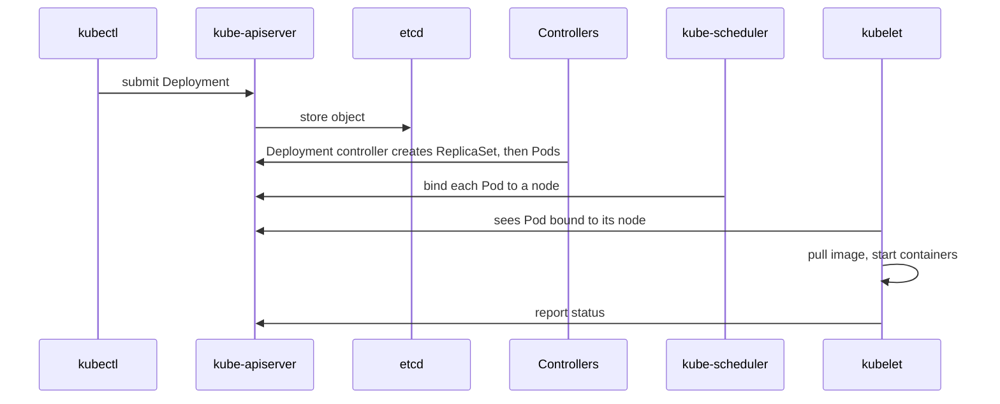

# Kubernetes and Cloud-Native Interview Preparation Guide

## Overview

These interviews test whether you understand what Kubernetes does for you, what it does not, and how to debug it when it misbehaves. Expect a mix of concepts, "what happens when" walkthroughs, and a live troubleshooting scenario. This guide contains no vendor exam questions. Facts below that quote behavior are from the Kubernetes documentation, linked inline.

Pair it with the [kubectl cheat sheet](../cli-cheat-sheet-kubectl.md), [Kubernetes troubleshooting](../troubleshooting/kubernetes-troubleshooting.md), the [Kubernetes topic index](../../topics/kubernetes.md) and the [Kubernetes specialist roadmap](../certification-roadmap-kubernetes-specialist.md).

---

## Architecture

### "What happens when I run `kubectl apply -f deployment.yaml`?"



*Everything goes through the API server; controllers, the scheduler and kubelets react to changes. Nothing talks to etcd except the API server.*

Key point: Kubernetes is a set of **control loops** that compare desired and actual state.

### Control plane versus node components
- Control plane: kube-apiserver, etcd, kube-scheduler, kube-controller-manager (and the cloud controller manager on cloud clusters).
- Node: kubelet, a container runtime, and kube-proxy (or a replacement networking data plane).

### "How does the scheduler pick a node?"
It filters nodes that cannot run the Pod (resources, taints, affinity, volume constraints), then scores the rest. The scheduler uses **requests**, not live usage. See the [resource management docs](https://kubernetes.io/docs/concepts/configuration/manage-resources-containers/).

---

## Workloads

| Object | Use it for |
|---|---|
| Deployment | Stateless apps with rolling updates |
| StatefulSet | Stable identity and storage per replica |
| DaemonSet | One Pod per node (agents, log shippers) |
| Job / CronJob | Run-to-completion and scheduled work |

### "How do rolling updates work, and how do you roll back?"
The default strategy is `RollingUpdate`, tuned with `maxSurge` and `maxUnavailable`. Commands:

```bash
kubectl rollout status deployment/web
kubectl rollout history deployment/web
kubectl rollout undo deployment/web
kubectl rollout undo deployment/web --to-revision=2
```

Know that readiness probes decide when a new Pod receives traffic, and `progressDeadlineSeconds` marks a stuck rollout.

[**📖 Kubernetes - Deployments**](https://kubernetes.io/docs/concepts/workloads/controllers/deployment/) - strategy, rollout and rollback.

### Probes
- **Liveness**: restart the container if it is stuck.
- **Readiness**: remove the Pod from Service endpoints until it is ready.
- **Startup**: give slow starters time before liveness applies.
A common mistake is a liveness probe that checks a dependency, so a database blip restarts every Pod.

---

## Resources and QoS

- **Requests** are what the scheduler reserves. **Limits** are enforced by the kubelet and kernel.
- Per the docs, CPU limits are enforced by throttling; memory limits by out-of-memory (OOM) kills, reactively.
- QoS classes: **Guaranteed** (requests equal limits for CPU and memory in every container), **Burstable**, and **BestEffort** (no requests or limits). Under node pressure, BestEffort is evicted first, then Burstable, then Guaranteed.

[**📖 Kubernetes - Pod Quality of Service classes**](https://kubernetes.io/docs/concepts/workloads/pods/pod-qos/) - class definitions and eviction order.

Interview trap: "Should every container have a CPU limit?" Defensible answers exist on both sides. Say what throttling does, say you would always set requests, and explain how you would decide on limits from measured data.

---

## Networking

- Every Pod gets its own IP; Pods reach each other without NAT (provided by the CNI plugin).
- **Service** types: ClusterIP, NodePort, LoadBalancer, ExternalName. A Service gives a stable virtual IP and DNS name over changing Pods.
- **Ingress** or **Gateway API** route HTTP into Services.
- **NetworkPolicy**: by default Pods are non-isolated; a Pod becomes isolated for a direction when a policy selects it for that direction, and then only listed traffic is allowed. Policies only work if the CNI enforces them.

[**📖 Kubernetes - Network Policies**](https://kubernetes.io/docs/concepts/services-networking/network-policies/) - isolation rules and examples.

---

## Storage

- PersistentVolume (PV), PersistentVolumeClaim (PVC), StorageClass for dynamic provisioning.
- Know access modes (ReadWriteOnce versus ReadWriteMany) and why a Pod can be stuck `Pending` when a volume is in another zone.
- StatefulSets use `volumeClaimTemplates` so each replica gets its own PVC.

---

## Security

- **RBAC**: Roles/ClusterRoles bound with RoleBindings/ClusterRoleBindings. Least privilege, and check with `kubectl auth can-i`.
- **Pod security**: run as non-root, drop capabilities, read-only root filesystem, and apply the Pod Security Standards through Pod Security Admission.
- **Secrets**: base64 is encoding, not encryption. Enable encryption at rest, restrict access, and prefer an external secrets manager with workload identity.
- **Supply chain**: pin image digests, scan images, sign and verify.

---

## Availability and scaling

- **HorizontalPodAutoscaler** scales replicas on metrics. Per the docs, CPU utilization is a percentage of the container *requests*, and if a container lacks a request the autoscaler takes no action for that metric.
- **VerticalPodAutoscaler** adjusts requests; it is a separate install, not core Kubernetes.
- **Node autoscaling** (Cluster Autoscaler or Karpenter) adds nodes for unschedulable Pods and consolidates underused ones.
- **PodDisruptionBudget** limits voluntary disruptions such as drains; it does not stop node crashes.

[**📖 Kubernetes - Horizontal Pod Autoscaling**](https://kubernetes.io/docs/concepts/workloads/autoscaling/horizontal-pod-autoscale/) - algorithm and metrics.
[**📖 Kubernetes - PodDisruptionBudget**](https://kubernetes.io/docs/tasks/run-application/configure-pdb/) - `minAvailable` and `maxUnavailable`.

See [Kubernetes cost optimization](../cost-optimization/kubernetes-cost-optimization.md) for how these interact with spend.

---

## Troubleshooting walkthroughs

Practise saying the **order** you check things. A good default:

```bash
kubectl get pods -A -o wide
kubectl describe pod <pod> -n <ns>        # events at the bottom
kubectl logs <pod> -n <ns> --previous     # crashed container
kubectl get events -n <ns> --sort-by=.lastTimestamp
kubectl top pod -n <ns>                   # needs metrics-server
```

| Symptom | First thoughts |
|---|---|
| `Pending` | Not enough resources, taints, unbound PVC, node selector mismatch (events say which) |
| `CrashLoopBackOff` | Read `--previous` logs; bad config, missing secret, failing probe |
| `ImagePullBackOff` | Wrong tag, registry auth (imagePullSecrets), network egress |
| `OOMKilled` | Memory limit too low or a leak; compare usage to the limit |
| Service has no endpoints | Selector does not match Pod labels, or Pods are not Ready |
| Node `NotReady` | kubelet, container runtime, disk or memory pressure, network |

Full detail: [Kubernetes troubleshooting](../troubleshooting/kubernetes-troubleshooting.md).

---

## Cloud-native concepts

- **12-factor** habits: config in the environment, stateless processes, logs to stdout.
- **Observability**: metrics, logs, traces; OpenTelemetry for instrumentation. See [observability basics](../../learn/concepts/observability-basics.md).
- **Service mesh**: mTLS, retries and traffic shifting at the cost of added complexity. Know when you do not need one.
- **Operators and CRDs**: extend the API and encode operational knowledge in a controller.
- **Helm versus Kustomize**: templating versus patching. See the [Helm cheat sheet](../cli-cheat-sheet-helm.md).
- **GitOps**: Argo CD or Flux reconcile cluster state from Git.

---

## Design prompts to practise

1. Design a multi-tenant cluster for ten teams. (Namespaces, RBAC, quotas, network policy, node pools, cost labels.)
2. A deployment causes errors only under load. How do you find out? (Metrics, saturation, throttling, HPA behavior, dependency limits.)
3. Zero-downtime upgrade of nodes. (PDBs, surge, readiness, drain order.)
4. Run a stateful database on Kubernetes or use a managed one? (Operational burden, backups, failure modes.)

## Questions to ask them
- Managed or self-run control plane? How often do you upgrade?
- How are cluster add-ons managed and who owns them?
- What is the on-call experience when a node pool fails?

## Related
- [Platform engineer interview guide](./platform-engineer-interview.md)
- [DevOps interview guide](./devops-interview.md)
- [kubectl cheat sheet](../cli-cheat-sheet-kubectl.md)
- [Container and Kubernetes service comparison](../service-comparison-containers-kubernetes.md)
