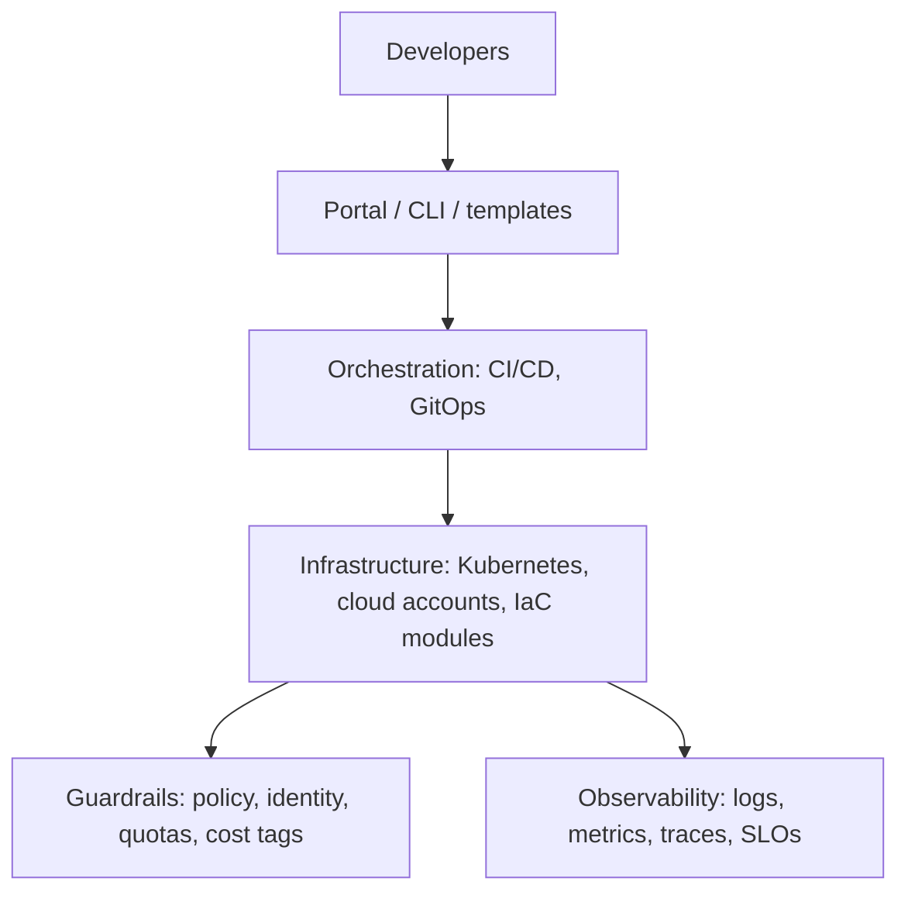

# Platform Engineer Interview Preparation Guide

## Overview

A platform engineer builds the internal paths other engineers use to ship software: self-service infrastructure, CI/CD, golden paths, and the guardrails around them. Interviews test whether you treat the platform as a **product** with users, not as a ticket queue. This guide covers the themes that come up and how to answer them. It contains no vendor exam questions.

Pair it with the [platform engineer roadmap](../certification-roadmap-platform-engineer.md), the [Platform Engineering topic index](../../topics/platform-engineering.md), and the [DevOps](./devops-interview.md) and [SRE](./sre-interview.md) guides.

---

## Core ideas to explain in plain words

### Platform as a product
- Your users are developers. Their time is the metric.
- Talk to them, measure adoption, and treat a low-use feature as a product problem, not a user problem.
- Offer a **paved road** (golden path): the easy way is also the compliant way. Teams can leave it, but they own the extra work.

### Self-service with guardrails
- A developer should create an environment, database or pipeline without a ticket.
- Guardrails (policy as code, quotas, templates) make "yes by default" safe.

### Reduce cognitive load
- Hide infrastructure detail developers do not need, but do not hide what they must debug.
- Good defaults beat long documentation.

### Measure the platform
- Delivery speed and stability: deployment frequency, lead time, change failure rate, time to restore (the four DORA metrics).
- Platform health: adoption, time to first deploy for a new service, support requests per team, and developer satisfaction surveys.

---

## Architecture and tooling questions

### "What would your internal developer platform include?"
A strong answer is layered, not a tool list:

*The platform stacks a developer interface over automation, infrastructure, and cross-cutting guardrails and observability.*

Say why each layer exists, then say what you would build **first** (usually the pipeline and one golden path, not the portal).

### "Build, buy, or adopt open source?"
- Adopt or buy for commodity parts (CI runners, secrets, ingress).
- Build only where it is your differentiator or glue.
- Count the **ongoing** cost: upgrades, on-call and support are the real price.

### "GitOps: how does it work and why use it?"
- The desired state lives in Git. An agent in the cluster (Argo CD or Flux) pulls and reconciles.
- Benefits: audit trail, easy rollback (revert a commit), drift detection, no cluster credentials in CI.
- Costs: secrets handling needs a plan, and debugging needs "is it Git, the controller, or the cluster?" discipline.

### "How do you manage infrastructure as code at scale?"
- Small, versioned modules with clear inputs and outputs.
- Remote state with locking, split by blast radius (per environment and per team), not one giant state.
- Plan on pull request, apply from a pipeline with approvals, and detect drift on a schedule.
- See [Terraform state and drift troubleshooting](../troubleshooting/terraform-state-and-drift-troubleshooting.md) and the [IaC decision matrix](../decision-matrix-iac-tool.md).

### "How do you enforce policy without becoming a blocker?"
- Shift left: lint and policy checks in the pull request with a clear message and a fix.
- Enforce at admission in the cluster for what cannot be bypassed (for example Kyverno or OPA Gatekeeper).
- Start in audit mode, publish the rules, and give an exception path with an expiry date.

### "Multi-tenancy in Kubernetes"
- Namespaces per team, with RBAC, ResourceQuota and LimitRange, and default-deny NetworkPolicy.
- Decide cluster-per-environment versus shared clusters on blast radius, cost and compliance.
- See [Kubernetes and cloud-native interview guide](./kubernetes-cloud-native-interview.md).

### "Where do secrets live?"
- In a secrets manager, not in Git or images. Workloads get short-lived credentials through workload identity (IRSA, Workload Identity, managed identity) instead of long-lived keys.

---

## Reliability and operations questions

### "How do you roll out a platform change safely?"
- Canary on a small set of internal teams first, then wider rings, with a rollback path you have tested.
- Announce, version, and deprecate with a date. Never change a golden path under teams silently.
- Read the [CrowdStrike postmortem](../postmortem-crowdstrike-2024.md) for what skipping staged rollout costs.

### "A shared cluster upgrade is due. Walk me through it."
1. Check API deprecations against your manifests and charts.
2. Upgrade a non-production cluster first and run smoke tests.
3. Confirm PodDisruptionBudgets and replica counts allow drains.
4. Upgrade the control plane, then node pools in batches.
5. Watch SLOs; keep the rollback plan (often "new node pool, move back").

### "How do you handle a noisy neighbour?"
- Requests and limits, quotas, node pools or taints for heavy workloads, and per-team dashboards so the team sees its own usage.

### "Design on-call for the platform team."
- Alert on user-facing platform SLOs (pipeline success, deploy time), not just host metrics.
- Runbooks per alert, a blameless review after incidents, and an error budget that decides feature work versus reliability work.

---

## Cost and governance

- Tag or label everything by team and service so cost can be shown back. See [FinOps principles](../cost-optimization/finops-principles.md) and [Kubernetes cost optimization](../cost-optimization/kubernetes-cost-optimization.md).
- Make the cheap choice the default (right-sized templates, scheduled shutdown of dev environments).

---

## Behavioral questions

Use situation, action, result, and keep the result measurable.

- "Tell me about a platform feature nobody used." (Show you asked users why and changed course.)
- "Tell me about saying no to a team." (Show a reason tied to risk and an alternative.)
- "Tell me about a migration you led." (Show communication, a pilot team and a rollback.)
- "How do you handle a team that bypasses the golden path?" (Understand the gap first; it is often a missing feature.)

---

## System design prompt to practise

> Design a platform so a new team can go from an empty repository to a production service in one day.

Cover: a service template, a pipeline with tests and security scans, environments and promotion, identity and secrets, observability by default, cost labels, and the support model. State what you leave out of version one.

## Questions to ask them
- Who are the platform's users and how do you measure their satisfaction?
- What is the split between building new capabilities and keeping the platform running?
- What does the on-call load look like?
- Who decides what goes on the golden path?

## Related
- [Platform engineer roadmap](../certification-roadmap-platform-engineer.md)
- [Platform Engineering topic](../../topics/platform-engineering.md)
- [DevOps interview guide](./devops-interview.md)
- [Kubernetes troubleshooting](../troubleshooting/kubernetes-troubleshooting.md)
