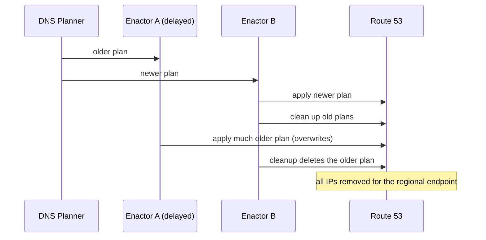
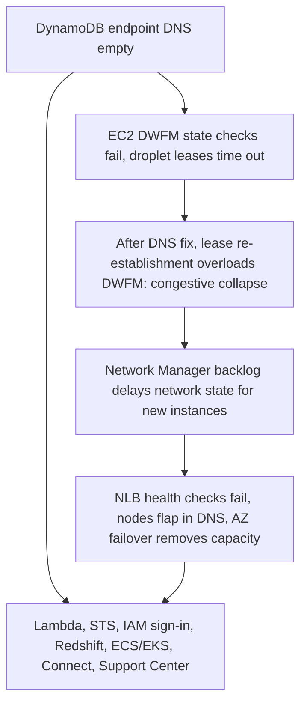

# Postmortem study guide - AWS us-east-1 DynamoDB DNS event, October 2025

> A real public postmortem repackaged as exam prep. Everything below comes from AWS's own post-event summary. Times are Pacific (PDT), as AWS states them.

## What happened

From 11:48 PM on 19 October to 2:20 PM on 20 October 2025, a DNS fault on the DynamoDB regional endpoint in US-EAST-1 started a chain of failures across many AWS services. AWS describes three periods of customer impact:

| Service | Impact window (PDT) |
|---|---|
| DynamoDB | 11:48 PM (19 Oct) to 2:40 AM (20 Oct): increased API error rates |
| EC2 | 2:25 AM to 10:36 AM: new instance launches failed (running instances were not affected); API errors and latency began at 11:48 PM and normalized by 1:50 PM |
| Network Load Balancer | 5:30 AM to 2:09 PM: increased connection errors on some load balancers |

## Root cause

AWS says a latent race condition in the DynamoDB DNS management system left the regional endpoint (`dynamodb.us-east-1.amazonaws.com`) with an incorrect, empty DNS record, and automation did not repair it.

The system has two parts: a **DNS Planner** that generates plans, and **DNS Enactors** that apply them to Route 53. Three Enactors run redundantly across Availability Zones.

*One Enactor was unusually delayed, applied a stale plan over a newer one, and cleanup then removed that plan, leaving the endpoint empty.*

In AWS's words, the delayed Enactor's earlier staleness check no longer applied by the time it acted. Once the active plan was deleted, later plan updates were blocked and operators had to intervene by hand.

## DynamoDB timeline (PDT)

| Time | Event |
|---|---|
| 11:48 PM (19 Oct) | DNS failures begin, including for internal AWS services |
| 12:38 AM | Engineers identify DynamoDB DNS state as the source |
| 1:15 AM | Temporary mitigations let some internal services connect and repair internal tooling |
| 2:25 AM | All DNS information restored |
| 2:32 AM | Global tables replicas caught up |
| 2:40 AM | Cached DNS records expire; customers reconnect |

## The cascade

*The diagram shows the order AWS describes: the root fault, then EC2 recovery work causing its own overload, then NLB health checks.*

- **EC2:** DropletWorkflow Manager (DWFM) state checks depend on DynamoDB. After DynamoDB recovered, DWFM tried to re-establish leases across the fleet and entered congestive collapse. At 4:14 AM engineers throttled incoming work and restarted DWFM hosts selectively; all leases were established by 5:28 AM. Network propagation backlog cleared by 10:36 AM, throttles were relaxed from 11:23 AM, and EC2 was normal at 1:50 PM.
- **NLB:** Health checks failed intermittently because of delayed network propagation. Monitoring detected it at 6:52 AM. At 9:36 AM engineers disabled automatic health check failover, and connection errors resolved. It was re-enabled at 2:09 PM.
- **Other services:** AWS lists Lambda, ECS/EKS/Fargate, Amazon Connect, STS, IAM console sign-in, Redshift and AWS Support Center, each with its own window. See the source for the full list.

[**📖 AWS - Summary of the Amazon DynamoDB Service Disruption in the Northern Virginia (US-EAST-1) Region**](https://aws.amazon.com/message/101925/) - the primary source for this page.

## What AWS says it is changing

- **DynamoDB:** DNS Planner and Enactor automation is disabled worldwide. AWS will fix the race condition and add protection against applying incorrect plans before re-enabling it.
- **NLB:** a velocity control limits how much capacity one NLB can remove when health check failures trigger AZ failover.
- **EC2:** a new test suite for the DWFM recovery workflow, and throttling of data propagation based on queue size.

## What this teaches

### Recovery can cause a second outage
DWFM collapsed after the dependency came back, because everything retried at once. Plan for thundering herds: backoff, jitter, throttles and a way to shed load. See [chaos engineering patterns](./architecture-patterns/chaos-engineering-patterns.md).

### Automation needs guards against stale actors
The Enactor's staleness check was valid only at one moment. When a component can act on old state, re-check at the point of write (compare-and-swap or a version fence).

### Cleanup is a destructive operation
Deleting an old plan removed the only active one. Destructive cleanup should refuse to remove what is currently live.

### Hidden dependencies on a single region
Services in other Regions were hit too (for example Redshift IAM-credential queries, per AWS). Map your control plane dependencies, not only your data plane. See [multi-region active-active](./architecture-patterns/multi-region-active-active.md) and [disaster recovery patterns](./architecture-patterns/disaster-recovery-patterns.md).

### Automatic failover can make things worse
NLB's health-check failover removed capacity during a partial failure. AWS added a velocity control. Limit how much any automatic action can remove at once.

## Cert mapping

The mapping below is this site's own editorial judgment, not from AWS's summary; the CKA / CKS row in particular is a conceptual stretch.

| Cert | Domains tested by this incident |
|---|---|
| **AWS Solutions Architect Pro (SAP-C02)** | Multi-region resilience, dependency mapping, DR strategy |
| **AWS DevOps Engineer Pro (DOP-C02)** | Incident response, automation safety, throttling |
| **AWS SysOps Administrator** | Monitoring, DNS and Route 53 behavior, health checks |
| **GCP Cloud DevOps Engineer** | Cascading failure, load shedding, postmortems |
| **CKA / CKS** | Control plane dependency and retry storms (conceptual) |

## Discussion questions

1. Which of your services would fail if your database endpoint resolved to nothing for three hours?
2. How long do your clients cache DNS, and what does that do to recovery time?
3. What would your retry behavior do the moment a dependency returns?
4. Where do you have automation that can delete the thing it should protect?
5. Which control plane calls does your failover plan make in the failing Region?

## Not covered

This page follows the summary only. It does not cover customer-side impact reports, third-party analysis, or anything AWS later published beyond that summary.

## Related

- [AWS S3 us-east-1 postmortem (2017)](./postmortem-aws-s3-2017.md)
- [Multi-region active-active](./architecture-patterns/multi-region-active-active.md)
- [Disaster recovery patterns](./architecture-patterns/disaster-recovery-patterns.md)
- [SRE roadmap](./certification-roadmap-devops-sre.md)
