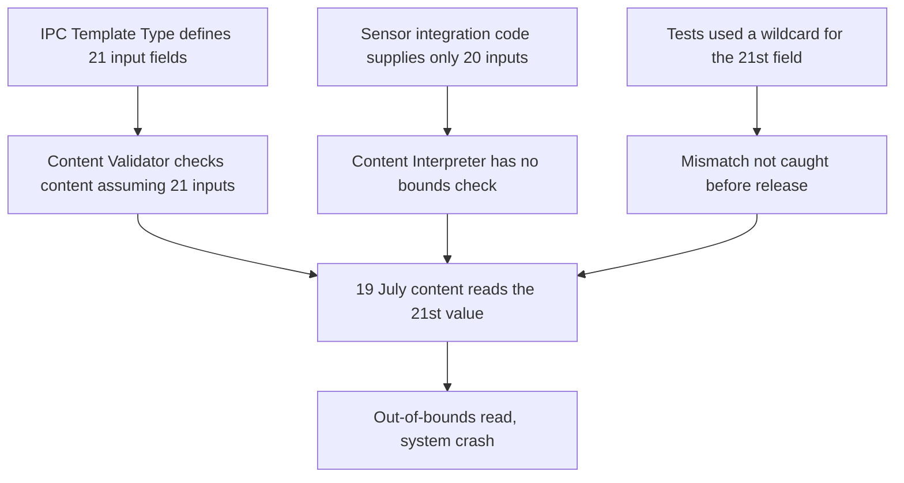

# Postmortem study guide - CrowdStrike faulty content update, July 2024

> A real public postmortem repackaged as exam prep. Everything below comes from CrowdStrike's own published root cause analysis. Where that report does not say something (for example the exact clock times of the release), this page leaves it out rather than guess.

## What happened

On 19 July 2024, CrowdStrike delivered a Rapid Response Content update (a new version of Channel File 291) to its Falcon sensor on Windows. On sensors that received it, the update caused a system crash. CrowdStrike's report says that as of 29 July at 5 p.m. PT, about 99% of Windows sensors were online compared with before the update, against a normal week-over-week variance of about 1%.

Two terms matter:

- **Sensor Content** ships inside a sensor release (code and compiled "Template Types").
- **Rapid Response Content** is configuration data delivered from the cloud as channel files. CrowdStrike states it is "configuration data; it is not code or a kernel driver."

## Timeline (as the RCA states it)

| Date | Event |
|---|---|
| February 2024 | Sensor 7.11 ships a new IPC Template Type (named pipes and other Windows interprocess communication). It defines 21 input fields. |
| Feb to July 2024 | IPC Template Instances are delivered in Channel File 291 and work in the field. Tests and early instances used a wildcard for the 21st field. |
| 19 July 2024 | Two more IPC Template Instances are deployed. One uses a non-wildcard criterion on the 21st input. Sensors that receive the new file crash at the next IPC notification. |
| 19 July 2024 | A Sensor Content Compiler patch that validates input counts is developed (in production 27 July). |
| 25 July 2024 | Bounds checking added to the Content Interpreter function that retrieves input strings. |
| 6 August 2024 | The RCA is published. Hotfix for sensors 7.11 and above is due by 9 August; Content Validator checks by 19 August. |

The RCA gives no hour-by-hour timeline of the release. Those details are in CrowdStrike's separate preliminary post incident review, which this page does not use.

## Root cause

*The diagram shows three independent weaknesses combining into one crash.*

The RCA names the combination: "the mismatch between the 21 inputs validated by the Content Validator versus the 20 provided to the Content Interpreter, the latent out-of-bounds read issue in the Content Interpreter, and the lack of a specific test for non-wildcard matching criteria in the 21st field."

The report states the fault was an out-of-bounds read, "not an arbitrary memory write issue," and that this was independently reviewed.

## Findings and what CrowdStrike changed

| Finding (from the RCA) | Mitigation CrowdStrike lists |
|---|---|
| Input count of a Template Type was not validated at sensor compile time | Compiler patch validates the number of inputs, and checked other Template Types on every platform |
| No runtime bounds check on Content Interpreter inputs for Channel File 291 | Bounds check and an input-array size check added; fuzz testing of the Channel 291 Template Type completed and being expanded |
| Template Type testing was too narrow (12 static test cases, wildcard in the 21st field) | Automated tests with non-wildcard criteria for each field, for all existing and future Template Types |
| Content Validator contained a logic error | New validator checks; validator restricted to wildcard-only in the 21st field |
| Template Instances were not tested inside the Content Interpreter | Every new Template Instance is now tested, not only the first |
| No staged deployment of Template Instances | Canary then successive rings with bake-in time; customer control over where and when content is deployed |

CrowdStrike also engaged two independent third-party vendors to review the sensor code, and is reviewing its quality process end to end.

[**📖 CrowdStrike - External Technical Root Cause Analysis, Channel File 291**](https://www.crowdstrike.com/wp-content/uploads/2024/08/Channel-File-291-Incident-Root-Cause-Analysis-08.06.2024.pdf) - the primary source for this page (PDF, 6 August 2024).

## What this teaches

### Treat configuration as code
The update was "just content," yet it crashed machines. Anything that changes runtime behavior needs the same tests, review and staged rollout as a code release.

### Staged rollout is a blast-radius control
The RCA's own fix is rings, canaries and bake-in time. Compare [cell-based architecture](./architecture-patterns/cell-based-architecture.md) and the canary lesson in the [Cloudflare regex postmortem](./postmortem-cloudflare-regex-2019.md).

### Validators must match the runtime
The validator assumed 21 inputs while the runtime supplied 20. Two components that each look correct can disagree. Contract tests across the boundary catch this.

### Wildcard-only tests hide bugs
Every test used a wildcard in the one field that was broken. Test each input with a realistic, non-trivial value.

### Fail safe in privileged code
The faulting module ran in the kernel at early boot, so a bad read became a crash. Bounds checks and fuzzing matter most where a fault cannot be recovered. This guide does not cover recovery steps for affected machines; the RCA does not either.

## Cert mapping

The mapping below is this site's own editorial judgment, not from the RCA; the CKA / CKS row in particular is a conceptual stretch.

| Cert | Domains tested by this incident |
|---|---|
| **AWS DevOps Engineer Pro (DOP-C02)** | Deployment strategies, change management, canary and rollback |
| **Azure DevOps Expert (AZ-400)** | Release strategy, deployment rings, safe rollout |
| **GCP Cloud DevOps Engineer** | SRE postmortems, release engineering, blast radius |
| **CKA / CKS** | Change safety and node-level risk in privileged agents (conceptual) |
| **Security+ / CISM** | Supply chain and vendor risk, lessons-learned cycle |

## Discussion questions

1. Which of your own "just config" changes bypass your normal test and rollout path?
2. How would you detect a validator and a runtime that disagree about a schema?
3. What would a ring-based rollout look like for an agent running on every endpoint you own?
4. Which vendors can push changes into your production without your approval? Can you control the timing?
5. What tests would you write for a field that is currently always wildcarded?

## Related

- [Cloudflare regex postmortem](./postmortem-cloudflare-regex-2019.md)
- [GCP networking postmortem](./postmortem-gcp-networking-2019.md)
- [Cell-based architecture](./architecture-patterns/cell-based-architecture.md)
- [Chaos engineering patterns](./architecture-patterns/chaos-engineering-patterns.md)
- [SRE roadmap](./certification-roadmap-devops-sre.md)
