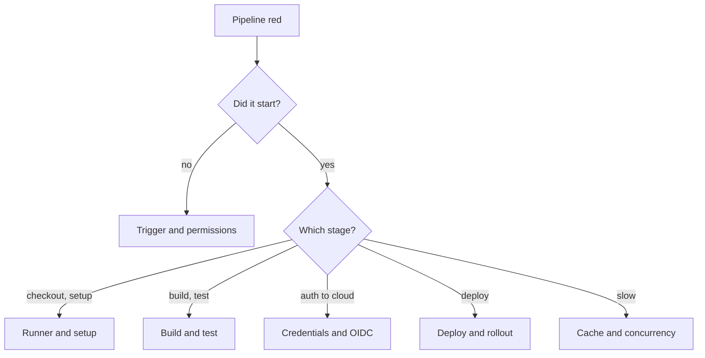

# CI/CD Pipeline Troubleshooting Guide

How to find out why a pipeline failed, flakes, runs slowly, or deploys the wrong thing. The examples use GitHub Actions because its syntax is checked against GitHub's documentation (linked per section); the diagnostic order applies to any CI system (GitLab CI, Azure Pipelines, Jenkins, Cloud Build). Other systems' syntax is not covered here.

---

## Triage: where did it fail?



*Locate the failing stage first; most time is lost debugging the wrong one.*

First questions, in order:
1. **What changed?** Compare the last green run with the first red one: code, workflow file, dependencies, runner image, secrets, or the outside world.
2. **Is it reproducible?** Re-run once. If it passes, treat it as flaky (see below).
3. **Is it only on some branches or forks?** That points to secrets, permissions or cache scope.

---

## Get more information

GitHub Actions has two debug switches. Set a secret or variable named `ACTIONS_STEP_DEBUG` to `true` for more verbose job logs, and `ACTIONS_RUNNER_DEBUG` to `true` to add runner diagnostic logs to the log archive (in a `runner-diagnostic-logs` folder). If a secret and a variable share a name, the secret wins. Anyone who can run a workflow can also enable both for a single re-run from the re-run dialog.

[**📖 GitHub Docs - Enabling debug logging**](https://docs.github.com/en/actions/how-tos/monitor-workflows/enable-debug-logging) - the two names and what each adds.

Locally, reproduce the exact commands from the failing step in a clean container with the same tool versions. Most "works on my machine" failures are version or environment differences.

---

## The pipeline did not start

| Cause | Check |
|---|---|
| Trigger does not match | `on:` filters (branches, paths, tags) exclude the change |
| Workflow file invalid | A YAML error means no run is created; read the error on the Actions tab |
| Workflow not on the default branch | Some event types read the workflow from the default branch |
| Run from a fork | Fork pull requests get reduced permissions and no secrets by default |
| Concurrency cancelled it | A newer run in the same concurrency group replaced it |

### Concurrency
```yaml
concurrency:
  group: deploy-${{ github.ref }}
  cancel-in-progress: true
```

Per the docs, `group` defines the concurrency group, and by default only queued (pending) runs are replaced. With `cancel-in-progress: true`, running jobs in the group are cancelled too. Do not cancel in-progress *deploys*; cancel in-progress *tests* instead.

---

## Permission errors (the token)

Symptom: "Resource not accessible by integration", or a step cannot push, comment or publish.

```yaml
permissions:
  contents: read
  pull-requests: write
```

The docs say that if you list any scope, every scope you do not list is set to `none`, so adding one permission can silently remove another. Job-level `permissions` overrides the workflow level. For pull requests from forks, write permissions are reduced to read-only unless an admin setting allows otherwise. Dependabot runs get a read-only token and can only use Dependabot secrets, unless `permissions` raises access.

Start from least privilege and add only what the failing step needs.

[**📖 GitHub Docs - Workflow syntax**](https://docs.github.com/en/actions/reference/workflows-and-actions/workflow-syntax) - `permissions`, `concurrency`, `GITHUB_TOKEN` behavior.

---

## Credentials to the cloud

Long-lived cloud keys in secrets expire, leak, and get rotated at the wrong time. GitHub's OpenID Connect (OIDC) support lets a workflow exchange a short-lived token with your cloud provider instead. GitHub generates a JWT per job, and the cloud provider checks its claims against your trust configuration.

Common failures, per GitHub's concept page:
- **Subject mismatch.** The `sub` claim looks like `repo:octo-org/octo-repo:environment:prod`. If the trust policy expects a branch, or a different environment name, validation fails.
- **Other claims differ** (`ref`, `repository`, `environment`, `aud`).
- **Subject format changed.** The page says repositories created after July 15, 2026 use an immutable default subject format that includes owner and repository IDs, so older trust conditions will not match those repositories.

Check the exact claim values in the failing job, then compare them to the role's trust policy. The workflow also needs permission to request the token; the permission key is in GitHub's OIDC reference, which this guide did not fetch, so confirm it there.

[**📖 GitHub Docs - OpenID Connect**](https://docs.github.com/en/actions/concepts/security/openid-connect) - concept page; the reference is linked from it.

---

## Build and test failures

| Symptom | Likely cause | Fix |
|---|---|---|
| Passes locally, fails in CI | Different tool or OS versions, missing env var, timezone, case-sensitive paths | Pin versions; run in the same container image |
| Fails only sometimes | Flaky test, shared state, timing, network call | See flaky tests below |
| Dependency install fails | Registry outage, rate limit, lock file mismatch | Use the lock file (`npm ci`, `pip install -r` with hashes), retry with backoff |
| Out of disk or memory | Large build or image layers | Clean up, use a bigger runner, split jobs |
| Timeout | Hung process or waiting for input | Set `timeout-minutes`; find the hung step |

### Flaky tests
1. Find the failure rate: count reds on unchanged code.
2. Quarantine, do not ignore. Move the test to a non-blocking job *and* open a ticket with an owner.
3. Fix the cause: sleep-based waits, test order dependence, real network calls, shared databases, wall-clock time.
4. Never solve flakiness with unlimited retries at the pipeline level; it hides real failures.

---

## Slow pipelines and caches

Caching rules from GitHub's documentation (`actions/cache`):
- The action looks for an exact `key` match, then partial matches, then each `restore-keys` entry in order. A partial match restores the most recently created matching cache.
- Existing caches cannot be modified; change the key to change contents.
- Keys are limited to 512 characters.
- The action searches the current branch, then the default branch. Pull request caches are scoped to the merge ref, and sibling or child branches cannot read each other's caches.
- Entries not accessed for over 7 days are removed. The default limit is 10 GB per repository; the oldest by last access are evicted first.

```yaml
- uses: actions/cache@v4
  with:
    path: ~/.npm
    key: npm-${{ hashFiles('**/package-lock.json') }}
    restore-keys: |
      npm-
```

(The `actions/cache` major version in this example is not verified against the docs fetched; check the current version in the action's repository.)

Other speed-ups: run independent jobs in parallel with `needs:` only where order matters, skip jobs by path filter, and build container images with layer caching.

[**📖 GitHub Docs - Dependency caching reference**](https://docs.github.com/en/actions/reference/workflows-and-actions/dependency-caching) - restore order, scope and limits.

---

## Deploy failures

### The deploy step succeeded but the app is broken
1. Does the pipeline wait for the rollout? For Kubernetes use `kubectl rollout status deployment/NAME`, which blocks until the rollout completes or fails.
2. Check readiness probes; a Pod that never becomes Ready stalls the rollout. `.spec.progressDeadlineSeconds` (default 600) marks it failed.
3. Roll back: `kubectl rollout undo deployment/NAME`.

[**📖 Kubernetes - Deployments**](https://kubernetes.io/docs/concepts/workloads/controllers/deployment/) - rollout status and undo.

### Wrong version deployed
- Deploy by immutable image digest or commit SHA, not `latest`.
- Make "what is running" queryable (version endpoint, labels) and compare to the pipeline run.

### Terraform in the pipeline
Lock errors, drift and state trouble have their own guide: [Terraform state and drift troubleshooting](./terraform-state-and-drift-troubleshooting.md). In CI, `terraform plan -lock-timeout=5m` avoids failures when two runs overlap, and `terraform plan -detailed-exitcode` gives a machine-readable "changes present" signal.

### Rollback and safe deploys
Prefer small changes, a canary or ring-based rollout, and a tested rollback. The [CrowdStrike postmortem](../postmortem-crowdstrike-2024.md) shows what skipping staged rollout costs, even for "just configuration".

---

## Secrets and security in pipelines
- Secrets are masked in logs, but a transformed secret (base64, JSON-wrapped) may not be. Never echo them.
- Do not run untrusted pull request code with write tokens or secrets.
- Pin third-party actions to a full commit SHA, and keep the default `GITHUB_TOKEN` read-only.

---

## Checklist: first 10 minutes of a red pipeline
1. Open the first failing step, not the last error.
2. Diff against the last green run.
3. Re-run once to test for flakiness.
4. Turn on step debug logging if the log is unclear.
5. Reproduce the failing command in a clean container.
6. Check status pages of dependencies (registry, cloud, CI provider).
7. Record the cause in the ticket so the next failure is faster.

## Related
- [DevOps CI/CD service comparison](../service-comparison-devops-cicd.md)
- [GitHub CLI cheat sheet](../cli-cheat-sheet-github-cli.md)
- [Terraform state and drift troubleshooting](./terraform-state-and-drift-troubleshooting.md)
- [Kubernetes troubleshooting](./kubernetes-troubleshooting.md)
