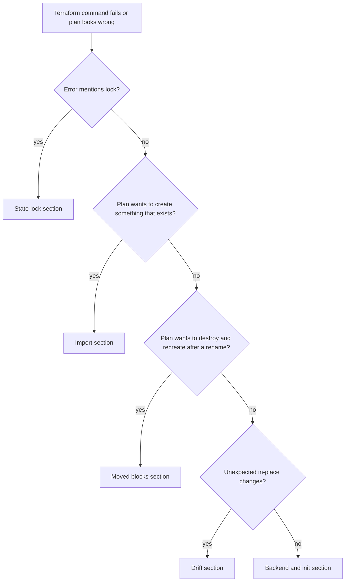

# Terraform State and Drift Troubleshooting Guide

Systematic fixes for the state problems that stop teams: locks, drift, renamed resources, resources that exist but are not in state, and broken backends. Commands and flags below were checked against the HashiCorp Terraform documentation linked in each section. Output text varies by version and provider, so error messages here are described, not quoted.

**Golden rules before touching state**
1. Nothing that edits state changes real infrastructure. It changes what Terraform *believes*. A later plan acts on that belief.
2. Take a backup first (`terraform state pull > backup.tfstate`). Commands that modify state always write a backup file, and the docs say this cannot be disabled.
3. Prefer code (`moved`, `import`, `removed` blocks) over CLI state surgery. Blocks go through review and run in the normal plan and apply flow.
4. Tell the team. If someone plans between your config change and your state change, the plan may destroy and recreate.

[**📖 Terraform - state command**](https://developer.hashicorp.com/terraform/cli/commands/state) - subcommands and backup behavior.

---

## Triage



*Start from the symptom: lock, missing from state, renamed, drifted, or backend trouble.*

---

## State lock problems

### Symptom: "Error acquiring the state lock"
Another run holds the lock, or a run died and left it behind.

1. **Check whether a run is really in progress** (CI job, a teammate, HCP Terraform run). If so, wait.
2. Retry with a wait: `terraform plan -lock-timeout=5m`. The flag makes Terraform retry for a period before erroring.
3. If the holder is dead, use the lock ID from the error message:

```bash
terraform force-unlock LOCK_ID
```

The docs state this removes only the lock and does not modify infrastructure. Behavior depends on the backend, and a local state lock cannot be cleared from another process. Add `-force` only to skip the confirmation prompt.

**Do not** use `-lock=false` to get around a lock in a shared workspace. The docs describe it as dangerous if others might run commands at the same time.

### S3 backend locking
The S3 backend documents `use_lockfile = true` (a `.tflock` object in the bucket; defaults to `false`) as the replacement for `dynamodb_table` (partition key `LockID`, type String), which it marks deprecated and planned for removal in a future minor version. You can set both while migrating. The role needs `s3:GetObject`, `s3:PutObject` and `s3:DeleteObject` on the lock file, so a permissions error on lock creation usually means a missing IAM action.

```hcl
terraform {
  backend "s3" {
    bucket       = "example-tfstate"
    key          = "prod/network.tfstate"
    region       = "us-east-1"
    use_lockfile = true
  }
}
```

The docs strongly recommend enabling S3 bucket versioning so you can recover state after an accidental deletion or human error.

[**📖 Terraform - force-unlock**](https://developer.hashicorp.com/terraform/cli/commands/force-unlock) - usage and cautions.
[**📖 Terraform - S3 backend**](https://developer.hashicorp.com/terraform/language/backend/s3) - locking options and permissions.

---

## Drift: real infrastructure differs from state

Drift happens when someone changes a resource in the console or another tool.

### Detect it
```bash
terraform plan -refresh-only
```

`-refresh-only` creates a plan whose goal is only to update state (and root outputs) to match reality. It shows what changed outside Terraform without proposing config-driven changes. Accept it with `terraform apply -refresh-only`.

For scheduled drift checks in CI, use the exit code:

```bash
terraform plan -detailed-exitcode
# 0 = succeeded, no changes   1 = error   2 = succeeded, changes present
```

### Decide what to do
| Situation | Action |
|---|---|
| The manual change was wrong | Run a normal `terraform apply`; config wins and reverts it |
| The manual change was right | Update the configuration to match, then plan until it is empty |
| An external system owns an attribute (autoscaler, tag injector) | Use `lifecycle { ignore_changes = [...] }` |
| One resource is wedged | `terraform plan -replace=ADDRESS` plans to replace it |

```hcl
resource "aws_instance" "app" {
  # ...
  lifecycle {
    ignore_changes = [tags]
  }
}
```

`ignore_changes` skips updates to the listed attributes after creation (or `all` for every attribute). The docs say Terraform only ignores attributes defined by the resource type. Use it sparingly; it hides real drift.

### Flags to know and not abuse
- `-refresh=false` disables the sync with remote objects. It is faster but plans from stale state.
- `-target=ADDRESS` limits planning to matching resources. Use it for recovery, not routine work, because it can leave the rest of the config unapplied.

[**📖 Terraform - plan command**](https://developer.hashicorp.com/terraform/cli/commands/plan) - `-refresh-only`, `-replace`, `-target`, `-lock-timeout`, `-detailed-exitcode`.
[**📖 Terraform - lifecycle meta-arguments**](https://developer.hashicorp.com/terraform/language/meta-arguments/lifecycle) - `ignore_changes`, `prevent_destroy`, `create_before_destroy`, `replace_triggered_by`.

---

## Resource exists but is not in state

Symptom: plan wants to create a resource, and apply fails with "already exists".

### Preferred: an import block
```hcl
import {
  to = aws_s3_bucket.logs
  id = "my-existing-bucket-name"
}

resource "aws_s3_bucket" "logs" {
  bucket = "my-existing-bucket-name"
}
```

Run `terraform plan`, review, then `terraform apply`. The `to` argument is the address in state; `id` is the provider's import ID (check each resource's documentation page for its format). A matching `resource` block must exist.

### Let Terraform draft the config
```bash
terraform plan -generate-config-out="generated_resources.tf"
```

Use a new file path; the docs say Terraform errors if the file exists. The feature is documented as experimental, and complex resources may produce invalid arguments (a conflicting-arguments error), in which case the file is still written and you fix it by hand. Always review the output before committing.

[**📖 Terraform - Import**](https://developer.hashicorp.com/terraform/language/import) - overview and links to single and bulk import.
[**📖 Terraform - Generate configuration**](https://developer.hashicorp.com/terraform/language/import/generating-configuration) - the flag and its limits.

---

## Renamed or moved resources (destroy and recreate surprise)

Symptom: you renamed a resource or moved it into a module, and the plan shows destroy plus create.

### Preferred: a moved block
```hcl
moved {
  from = aws_instance.a
  to   = aws_instance.b
}
```

Before planning, Terraform renames the state object at `from` to `to`, so nothing is destroyed. Keep the block in the code so every environment picks up the rename.

### CLI alternative
```bash
terraform state mv aws_instance.a aws_instance.b
terraform state mv 'aws_instance.web[0]' 'aws_instance.app[0]'
terraform state mv module.app module.parent.module.app
```

Add `-dry-run` to list matches without moving. Both addresses must be the same kind of object and the same resource type. Quote brackets so your shell does not eat them.

[**📖 Terraform - moved block**](https://developer.hashicorp.com/terraform/language/block/moved)
[**📖 Terraform - state mv**](https://developer.hashicorp.com/terraform/cli/commands/state/mv)

---

## Stop managing a resource without destroying it

Symptom: you want Terraform to forget a resource but leave it running.

### Preferred: a removed block
```hcl
removed {
  from = aws_instance.example

  lifecycle {
    destroy = false
  }
}
```

Per the docs, "Set `destroy` to `false` to remove the resource from state without destroying the actual resource." The docs page's own example uses `destroy = true`; the `destroy = false` block above is built from its syntax. Remove the resource block from the config in the same change (the page does not state this requirement).

### CLI alternative
```bash
terraform state rm -dry-run aws_instance.example
terraform state rm aws_instance.example
```

The docs warn that a later plan will propose creating a new object for each forgotten instance, which can fail on name conflicts. They recommend `removed` blocks because they can be reviewed in the normal plan and apply flow.

[**📖 Terraform - removed block**](https://developer.hashicorp.com/terraform/language/block/removed)
[**📖 Terraform - state rm**](https://developer.hashicorp.com/terraform/cli/commands/state/rm)

---

## Inspect and recover state

```bash
terraform state list                    # every address in state
terraform state show aws_instance.app   # attributes of one object
terraform state pull > backup.tfstate   # download current state
```

- `terraform state list`, `show` and `pull` are read operations. Read-only subcommands do not write backups.
- If state was deleted or corrupted, restore the previous object version from the bucket (this is why versioning matters), then run `terraform plan` to confirm.
- State can contain secrets in plain text. Restrict who can read it. The docs note that anyone who can read remote state outputs effectively has access to the whole snapshot.

[**📖 Terraform - terraform_remote_state**](https://developer.hashicorp.com/terraform/language/state/remote-state-data) - sensitivity warning.

---

## Backend and init problems

| Symptom | Likely cause | Fix |
|---|---|---|
| "Backend configuration changed" | You edited the backend block | `terraform init -migrate-state` to copy state to the new backend, or `terraform init -reconfigure` to start using the new settings without migrating |
| Provider version conflicts | Lock file pins an old provider | `terraform init -upgrade` selects the newest version allowed by constraints and ignores the lock file selections |
| Credentials in the backend block | Hard-coded secrets | Move them out and pass with `-backend-config=...` or environment variables |
| Access denied reading state | Role lacks bucket permissions | Check IAM for the state object and lock file |

`-reconfigure` discards the existing backend configuration and does not migrate state; `-migrate-state` copies it. Choosing the wrong one is how teams "lose" state, so read the prompt.

[**📖 Terraform - init command**](https://developer.hashicorp.com/terraform/cli/commands/init) - `-upgrade`, `-reconfigure`, `-migrate-state`, `-backend-config`.

---

## Prevention checklist
- Remote state with locking and versioning; one state per blast radius.
- Plan on pull request, apply from the pipeline only, and nobody applies from a laptop.
- Scheduled `terraform plan -detailed-exitcode` to catch drift early.
- `prevent_destroy = true` on data stores. The docs note it does not stop destruction if you remove the resource's configuration.
- Restrict console write access in production so drift is rare.

## Related
- [Terraform CLI cheat sheet](../cli-cheat-sheet-terraform.md)
- [CI/CD pipeline troubleshooting](./cicd-pipeline-troubleshooting.md)
- [IaC decision matrix](../decision-matrix-iac-tool.md)
- [AWS troubleshooting](./aws-troubleshooting.md)
