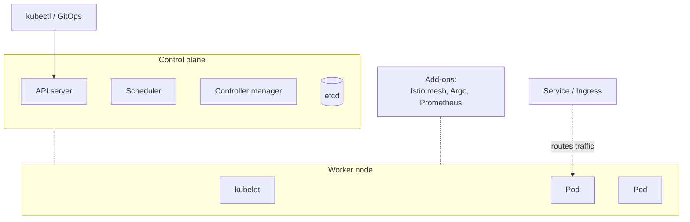

# Kubernetes

K8s primitives, distributions, security, operations. Eight years past 1.0, K8s is no longer optional knowledge for anyone touching production infrastructure.

---

## Learn

- [Kubernetes in 10 minutes](../learn/concepts/kubernetes-in-10-minutes.md) - pods, deployments, services, namespaces
- [Containers vs VMs](../learn/concepts/containers-vs-vms.md) - what containers actually are
- [IaaS / PaaS / SaaS](../learn/concepts/iaas-paas-saas.md) - where K8s sits
- [Your first Docker container](../learn/day-one/docker-first-container.md) - build and run an image before you orchestrate one
- [GitOps explained](../learn/concepts/gitops-explained.md) - Argo CD and Flux reconcile clusters from Git
- [Service mesh explained](../learn/concepts/service-mesh-explained.md) - Istio, Linkerd and Cilium for service-to-service traffic

---

## Compare

- [Containers and Kubernetes services](../resources/service-comparison-containers-kubernetes.md) - EKS vs AKS vs GKE vs OpenShift vs self-hosted

---

## Reference

- [Architecture pattern: Microservices](../resources/architecture-patterns/microservices-architecture.md)
- [Architecture pattern: Cell-based](../resources/architecture-patterns/cell-based-architecture.md)
- [Troubleshooting: Kubernetes](../resources/troubleshooting/kubernetes-troubleshooting.md)
- [CLI cheat sheet: kubectl](../resources/cli-cheat-sheet-kubectl.md)
- [CLI cheat sheet: Helm](../resources/cli-cheat-sheet-helm.md)

---

## Build

- [Kubernetes cluster setup](../resources/hands-on-projects/kubernetes-cluster-setup.md) - cluster end-to-end
- [Build a CI/CD pipeline](../resources/hands-on-projects/build-ci-cd-pipeline.md) - container builds and rollouts
- [GitOps with Argo CD](../resources/hands-on-projects/gitops-with-argo-cd.md) - deploy, promote and roll back by Git commit

---

## Certify

**CNCF**
- [KCNA - Kubernetes and Cloud Native Associate](../exams/kubernetes/kcna/) - foundational
- [KCSA - Kubernetes Security Associate](https://security.noblerworks.com/exams/kubernetes/kcsa/)
- [CKA - Certified Kubernetes Administrator](../exams/kubernetes/cka/)
- [CKAD - Certified Kubernetes Application Developer](../exams/kubernetes/ckad/)
- [CKS - Certified Kubernetes Security Specialist](https://security.noblerworks.com/exams/kubernetes/cks/)
- [PCA - Prometheus Certified Associate](../exams/kubernetes/pca/) - observability
- [ICA - Istio Certified Associate](../exams/kubernetes/ica/) - service mesh

**Vendor distributions**
- [Red Hat OpenShift Administrator (EX280)](../exams/redhat/openshift-administrator-ex280/)

**Cloud-side managed K8s**
- AWS EKS coverage in [SAA](../exams/aws/associate/solutions-architect-saa-c03/), [DVA](../exams/aws/associate/developer-dva-c02/), [DOP](../exams/aws/professional/devops-engineer-pro-dop-c02/)
- Azure AKS coverage in [AZ-104](../exams/azure/az-104/), [AZ-400](../exams/azure/az-400/)
- GCP GKE coverage in [Cloud Engineer](../exams/gcp/cloud-engineer/), [Cloud DevOps Engineer](../exams/gcp/cloud-devops-engineer/)

**Adjacent**
- [HashiCorp Consul Associate](../exams/hashicorp/consul-associate/) - service mesh alternative
- [HashiCorp Nomad study track](../exams/hashicorp/nomad-associate/) - non-K8s scheduler (no current exam)
- [Cisco CCNA](../exams/cisco/ccna-200-301/) - the underlying network you'll debug

---

## Roadmap

The full-stack view lives in **[Kubernetes Specialist roadmap](../resources/certification-roadmap-kubernetes-specialist.md)** and **[Platform Engineer roadmap](../resources/certification-roadmap-platform-engineer.md)**.
